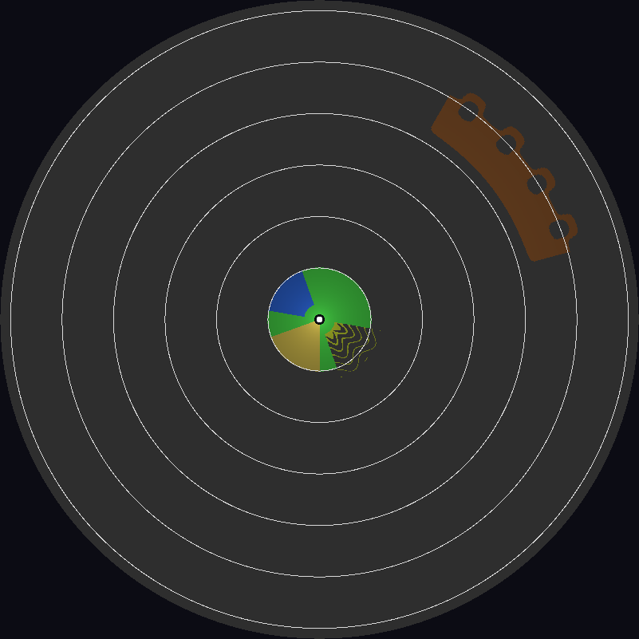

# Rotating search radar simulator (MATLAB)

A simple, modular MATLAB simulation of a 170 MHz (VHF) rotating search radar. The
receive antenna is a column of 48 elements (selectable) with digital
beamforming (DBF) in elevation, and every PRI holds a short and a long
sub-pulse. Everything from the 120 MHz ADC samples on the 30 MHz IF down to
the PPI display is simulated. Each processing block is a short function in
`src/`. All parameters are in one file, `radar_config.m`.

The code needs no MATLAB toolbox (UDP streaming uses `udpport` or Java). It
was tested with GNU Octave 8.4. The folders `radar_receiver_windows/` and
`radar_receiver_linux/` (two CLion projects with the same sources) hold a C
version of the whole receiver processing (CMake project for CLion). It
processes the DDC output that the simulator streams over UDP and has an
optional Qt PPI and serial output (see `radar_receiver_windows/README.md`
or `radar_receiver_linux/README.md`; below `radar_receiver_<os>`).

```
 PRI:  short pulse 25 us at 0 | receive (near range) | long pulse 150 us at 200 us | receive (far range)
 per target: position from its motion -> power from the radar equation (Swerling 1)
 echoes + clutter + Tx leakage (40 dB isolation), 30 MHz IF, 48 elements
 x STC (attenuation over the receive window) + thermal noise
 x receiver gain (60 dB) -> ADC 120 MHz, 16 bit, ENOB 12.7 -> int16
        |                       \--> optional raw data: output/raw_pulses/pulse_<n>.mat
        v
 DDC: x*cos(30 MHz) | x*(-sin(30 MHz)) -> FIR h1, /10 -> FIR h2, /6 (2 MHz) or /3 (4 MHz)
      (int16 coefficients with 13 fractional bits, time-domain sliding valid convolutions,
       every stage rounded and saturated to int16)                     -> int16 [nDdc x 48]
        |                       \--> optional DDC files: output/ddc_pulses/ddc_<n>.mat
        |                             (replay_ddc_udp.m sends them later with the PRI timing)
        |                       \--> optional UDP: int16 DDC output + pulse/scan/azimuth header
        |                             (-> radar_receiver_<os>/, the same processing in C)
        v  split in time: short-pulse samples | long-pulse samples
 DBF (21 x 48 matrix, off for 1 element)                   -> [21 beams x nSamples] per sub-pulse
 Pulse compression (valid convolution): matched filter (Taylor for LFM) or, for a phase code,
         the mismatch filter of inputs/phase_code.mat      -> [21 beams x nRange]   (range/delay axes)
 CPI buffer (circular, the pulses of one CPI)              -> [21 x nRange x 114], short and long
 MTI  fixed PRF: 3-pulse canceller | staggered: weights from file | or an FIR filter from file (cfg.mti.type)
 Doppler fixed: Hamming + FFT 128 (next power of 2 of 114) | staggered: de-interleave, Hamming, FFT 32, NCI
 CFAR on every range-Doppler map: CA, GO, SO or OS detector (cfg.cfar.type) with the
         2-D, 1-D range or 1-D Doppler window (cfg.cfar.method),
         in a selectable range interval per sub-pulse, range window shifted inwards at the edges
 Pruning (local peaks + sidelobe blanking) -> peak interpolation (Doppler, elevation: cfg.report)
         -> plot extraction (azimuth peak picking)
 Tracking (optional, cfg.track.method): 'ekf' EKF, 2-D (range, azimuth) or 3-D (+ elevation),
          constant velocity or constant acceleration, global nearest neighbour (GNN) association;
          'pmbm' multi-target Bayesian tracker: PMBM filter with IMM-UKF state estimation
          (CV / CA / coordinated turn), 2-D or 3-D; 'tomht' track-oriented MHT (k-best global
          hypotheses, N-scan pruning) with the same IMM-UKF filter
 PPI display (updated while the antenna turns): plots / detections / raw video, tracks, block, console and display times
```

## 170 MHz (VHF)

The carrier is 170 MHz (`cfg.fc`, wavelength 1.76 m; it was 3 GHz). What
changes with the carrier, and how the configuration and the processing
take it into account:

* **Receiver gain, dynamic range and STC.** The echo power grows with the
  wavelength squared: targets and clutter are 24.9 dB stronger at the ADC
  than at 3 GHz, the noise is not. With the receiver gain of 60 dB the near
  clutter (1 km to the 10 km horizon) at the start of the receive windows
  is up to 32 dB above the full scale of the ADC: 6 - 9% of the receive
  samples are clipped (`adc_overload.m`; `run_radar_sim` warns). Clipped
  clutter is no longer cancelled by the MTI, and clipped echoes give
  intermodulation products in other Doppler bins and beams (25 plots for
  the 6 targets of the six-target scenario). Lowering the gain to 30 dB
  avoids the clipping but costs 2.2 dB of SNR everywhere (thermal noise only
  5.7 LSB at the ADC: ADC noise 1.0 dB, rounding of the 16-bit DDC output
  1.2 dB). The receiver therefore keeps 60 dB and has an **STC**
  (sensitivity time control, `cfg.rx.stc`, `stc_gain.m`): an attenuator in
  front of the receiver whose attenuation falls with the time dt since the
  end of the transmitted pulse, given as the equivalent range c dt/2 (the
  nearest range whose echoes still arrive then). It attenuates the echoes,
  not the receiver noise (which is added after it), so it lowers the
  sensitivity only early in each receive window, where the echoes are
  strong. `cfg.rx.stc.curve` (short-pulse window, 40 dB at 0 - 1 km, 0 dB
  from 10.5 km) follows the clutter peak above full scale plus 6 dB
  (`stc_demo.m` derives it): no sample is clipped (0.000%), the thermal
  noise is 180 LSB at the ADC (no ADC or DDC loss), and short-pulse targets
  beyond 10.5 km get the 2.2 dB back. The long-pulse window starts with
  the eclipsed long-pulse echo of every target nearer than its blind range
  (22.5 km): its compressed response gives false plots up to 22.5 km behind
  the target (12 for a 10 m^2 target at 5 km). `cfg.rx.stc.curveLong`
  (60 dB at 0 - 3 km, 0 dB from 22.5 km, roughly R^4) attenuates it below
  the noise: no such false plot in `test_vhf_challenges` (5 - 21 km, up to
  10 m^2). It costs the long-pulse targets at 23 - 40 km up to 13 dB of SNR
  (a 1 m^2 target at 23 km still has 57 dB after the Doppler processing,
  22 dB are needed; from 40 km on nothing); `snr_budget.m` includes the
  STC. The STC also tapers the echo of such a target (its first part
  arrives while the attenuation is still high), which raises its range
  sidelobes: with the default LFM pulse from -36 dB to -26 dB (23 km) and
  -32 dB (26 - 30 km), still more than the sidelobe margin (20 dB) below the
  peak, so the pruning removes them. Phase codes are much more sensitive to
  the taper: with the P4 code and its mismatch filter -11 dB at 23 km,
  -18 dB at 30 km and -24 dB at 40 km (-33 dB without STC), so a strong
  long-pulse target there can give range-sidelobe plots. With
  `cfg.rx.stc.curveLong = []` (the clutter curve, which the eclipsed clutter
  at the start of the long-pulse window needs anyway) it is -15 to -19 dB at
  23 - 28 km and -33 dB from 33 km on, but strong near targets give eclipse
  ghosts again: with phase codes choose between the two. This replaces the
  eclipse blanking of the previous version (which removed such detections
  after the CFAR, and with them possibly a real target behind a near one).
  `stc_demo.m` shows the curves, the ADC samples of a PRI, the clipping,
  the SNR against range and the eclipsed echo with and without the STC
  (`output/stc_demo/*.png`). `cfg.rx.stc.enable` (section "STC" of
  `radar_config.m`) switches it on or off; without it lower
  `cfg.rx.gain_dB` to 30 dB (the run summary says whether the STC is on, and
  the ADC overload warning says to switch it on when it is off).
* **Doppler.** With the fixed PRF (1 kHz, 128 bins) a Doppler bin is
  6.9 m/s and the radial velocity is unambiguous within +-441 m/s (blind
  speed 882 m/s); the MTI notch is +-2 bins (+-13.8 m/s). With the staggered
  PRF the de-interleaved rows are sampled every sum(PRI) = 3.92 ms:
  +-112 m/s unambiguous and blind speeds at multiples of 225 m/s, where the
  target folds into the notch. In the six-target scenario T1 (-236 m/s) and
  T6 (210 m/s) are therefore not detected with the staggered PRF.
  `snr_budget.m` gives the SNR in the best Doppler bin the CFAR tests and
  `print_snr_budget` marks such targets ("blind speed"). At VHF the fixed
  PRF is the better choice.
* **Unambiguous velocities.** The plots of the fixed PRF carry the true
  radial velocity (no target is faster than 441 m/s). The tracker uses it
  as a measurement (`cfg.track.useRadialVelocity`, see Tracking): the track
  velocity converges in two scans instead of three to four, and with the
  staggered PRF the folded plot velocity is unfolded with the track, so the
  track velocities are unambiguous at the end of the processing in both
  modes.
* **Antenna and clutter.** The element spacing stays 0.66 wavelength
  (1.16 m: the 48-element column is 56 m high), so the patterns and the DBF
  matrix are the same as before. The internal clutter motion (0.1 m/s) is
  0.1 Hz; the clutter spectrum is set by the scan modulation, as before.
* **Processing time.** False detections (clutter residue, sidelobes of
  very strong targets, a CFAR threshold lowered in the PPI) slow the
  processing down only a little: the CA-CFAR costs the same at any
  threshold, the pruning takes maxima over the whole map when there are
  many detections, so its time is bounded by the map size (see Pruning
  below), and the C receiver does the local peak test inside its CFAR,
  finds the plot extractor groups in a hash grid and selects the noise
  floor median among a few values (`radar_receiver_<os>/README.md`, Speed: one
  element, 80 km, 0.35 ms instead of 1.44 ms per PRI at the default
  threshold with 3 threads of a small VM, 0.87 ms instead of 2.33 ms at
  6 dB). With a CFAR
  threshold so low that a large part of the cells are false alarms
  (Pfa 1e-2 and more) the plot extractor and above all the tracker still
  get thousands of false plots. The simulator sends the DDC output of one
  PRI per loop, so its UDP rate is the loop rate: `results.priTime_s` is
  the time of every PRI.
* **Console output.** With a low CFAR threshold printing every plot and
  track can take longer than the processing. `cfg.console.enable` switches
  the console output of MATLAB on or off, `cfg.console.plots` only the
  lists of plots and tracks; the C receiver takes `consolePlots` from the
  configuration file as its default (`--quiet` / `--print-plots` override
  it).

Six targets, one scan, 170 MHz, 60 dB with STC: fixed PRF 6 plots (all
targets, no false plot, no ADC sample clipped), staggered PRF 4 plots (T1
and T6 at blind speeds, no false plot). The 3 GHz configuration with only
`cfg.fc` changed (60 dB, no STC) gave 25 plots for
the 6 targets (14 eclipsed echoes, 3 clutter residues, 2 clipping
products); its false plots come back every scan and become confirmed false
tracks (see Tests: `test_multi_scan`).

## Quick start

```matlab
results = run_radar_sim;            % default configuration (full 360 deg scan)

cfg = radar_config;                 % or change parameters first
cfg.prf.mode = 'staggered';
cfg.clutter.enable = false;
cfg.ant.nElements = 1;              % a single antenna: no beamforming
cfg.sim.sectors_deg = [20 45];      % only simulate this azimuth sector
cfg.io.saveRaw = false;             % recordings per PRI: raw ADC data and/or DDC output
cfg.io.saveDdc = true;
cfg.console.plots = false;          % no list of every plot and track (cfg.console.enable = false: no console output)
results = run_radar_sim(cfg);

cfg = radar_config;                 % another test scenario (or set cfg.scenario.type in radar_config.m)
cfg.scenario.type = 'challenge';    % 'six' (default), 'challenge' (10 hard targets) or 'random' (10 random targets)
cfg.targets = target_scenario(cfg); % the targets of the scenario
results = run_radar_sim(cfg);
replay_ddc_udp;                     % send the DDC files over UDP with the PRI timing

cfg = radar_config;                 % only the DDC files, in parallel (parfor, Parallel Computing Toolbox)
cfg.io.saveRaw = false;
cfg.ddc.outputRate_Hz = 4e6;        % DDC output at 2 MHz (default) or 4 MHz
info = generate_ddc_files(cfg, 8);  % 8 workers -> output/ddc_pulses/ddc_<n>.mat
% (the same without MATLAB: radar_receiver_<os>/build/radar_generate_ddc, see below)

cfg = radar_config;                 % new options (all in radar_config.m)
cfg.wave.long.enable = false;       % sub-pulses on/off ...
cfg.wave.short.fc_Hz = 165e6;       % ... and on their own carrier ([] = cfg.fc)
cfg.proc.cpiMode = 'manual';  cfg.proc.cpiLength = 96;   % CPI length 'auto' or 'manual'
cfg.mti.maxRange_m = 30e3;          % clutter filter only up to 30 km (Inf = everywhere)
cfg.io.saveMf = true;  cfg.io.saveDoppler = true;        % matched filter / Doppler output per PRI
cfg.track.method = 'tomht';         % 'ekf', 'pmbm' or 'tomht' (track-oriented MHT, IMM-UKF)
results = run_radar_sim(cfg);

cd tests
run_all_tests                       % SNR budget, UDP, ghost and six-target tests
```

C receiver (see `radar_receiver_<os>/README.md`):

```matlab
cfg = radar_config;  cfg.udp.enable = true;
export_receiver_config(cfg);        % configuration file for the C receiver
% start radar_receiver_<os>/build/radar_receiver --ppi, then:
results = run_radar_sim(cfg);
```

The configuration file of the C receiver can also be written without
MATLAB: the program `radar_export_config` of the receiver project (a run
configuration of the same name in CLion) reads `radar_config.m` itself and
writes the same `config/radar_config.bin` (see `radar_receiver_<os>/README.md`,
"Configuration without MATLAB").

`make_input_files.m` creates the default input files in `inputs/`. The
simulator calls it automatically when a file is missing, or when a default
file was built for other values (for example after you change
`cfg.ant.nElements` or `cfg.ant.tilt_deg`). Replace a file with your own data
(same variable names) to simulate another antenna, filter set or stagger.

## Files

| File | Purpose |
|---|---|
| `radar_config.m` | all user parameters |
| `export_receiver_config.m` | writes the configuration of the C receiver (`radar_receiver_<os>/config/radar_config.bin`; without MATLAB: `radar_export_config` of the receiver project) |
| `run_radar_sim.m` | main loop: generation, recording, DDC/streaming, processing, display |
| `replay_ddc_udp.m` | sends recorded DDC files (`ddc_<n>.mat`) over UDP, unchanged, with the original PRI timing |
| `generate_ddc_files.m` | simulates every PRI only up to the DDC output and saves the DDC files, the PRIs in parallel (`parfor`) |
| `make_input_files.m` | default input .mat files |
| `src/setup_radar.m` | derives the PRI timeline, NCO, DDC segments, pulse compression filters (matched / mismatch), axes, CPI length, FFT length, CFAR factor ... |
| `src/mismatch_filter.m`, `ddc_pulse.m` | mismatch filter with the smallest peak sidelobe for a code or a sampled pulse; the pulse after the DDC filters |
| `src/generate_rx_signal.m`, `clutter_init.m`, `clutter_signal.m`, `adc_sample.m` | signal generation |
| `src/clutter_terrain.m` | terrain map of the clutter: land, mountains, hills, desert, sea; shadowing and horizon, elevation groups |
| `src/clutter_cnr.m` | CNR of uniform clutter at the matched filter output (`cfg.clutter.cnr_dB` -> sigma0) |
| `src/stc_gain.m` | STC: gain of the attenuator in front of the receiver over the PRI (`cfg.rx.stc`; 1 with `cfg.rx.stc.enable = false`) |
| `src/stc_advice.m` | the hint of the ADC overload warnings: switch the STC on, or raise its attenuation |
| `clutter_map.m` | picture of the clutter terrain (types, shadowed cells, CNR per cell) -> `output/clutter_map.png` (`docs/clutter_map.png`: the default map) |
| `stc_demo.m` | STC demonstration: curves, ADC samples of a PRI, clipping, SNR against range, eclipsed echo of a near target (figures in `output/stc_demo`) |
| `src/adc_overload.m` | fraction of the ADC samples of the receive intervals at full scale (receiver gain too high, STC off) |
| `src/target_rcs.m`, `draw_target_rcs.m` | Swerling 1 target RCS (a new value every scan) |
| `src/save_pulse_file.m`, `save_ddc_file.m`, `pulse_header.m` | raw ADC data / DDC output of a PRI to a .mat file, its header |
| `src/ddc.m`, `fir_decimate_valid.m`, `ddc_decimation.m` | two-stage DDC with I/Q mixer, decimation and filter file of the 2 / 4 MHz output |
| `src/udp_sender_open.m`, `udp_make_packets.m`, `udp_send_pulse.m`, `udp_send_packets.m`, `udp_send_datagram.m`, `udp_sender_close.m`, `udp_receiver_open.m`, `udp_receive_pulse.m` | UDP streaming of the DDC output (sender and reference receiver) |
| `src/ddc_segment.m` | DDC samples of a sub-pulse for the pulse compression (zeros outside its receive interval) |
| `src/digital_beamforming.m` | DBF |
| `src/matched_filter.m`, `plot_range_profile.m` | pulse compression, range/delay/index plots |
| `src/cpi_buffer_*.m` | circular CPI buffers |
| `src/mti_filter.m`, `doppler_process.m` | clutter filter (canceller or FIR filter, `cfg.mti.type`), Doppler processing |
| `src/cfar_detect.m` | CFAR block: the detector of `cfg.cfar.type` with the window of `cfg.cfar.method`, MTI notch |
| `src/cfar_ca.m`, `cfar_goso.m`, `cfar_os.m` | CA (cell averaging), GO / SO (greatest / smallest of the half windows) and OS (order statistic) CFAR, each with the 2-D, 1-D range and 1-D Doppler window |
| `src/cfar_alpha.m`, `cfar_statistic.m`, `cfar_quadrature.m` | threshold factor of a detector for a Pfa; distribution of its noise statistic; the quadrature of the Pfa integral |
| `src/track_setup.m`, `track_init.m`, `track_update.m`, `track_report.m` | tracking block: settings, the tracker of `cfg.track.method` (`track_update.m` calls `track_ekf.m` or `track_pmbm.m`), the tracks for the display |
| `src/track_ekf.m` | EKF tracker (2-D / 3-D, CV / CA model, GNN association; `cfg.track.method = 'ekf'`) |
| `src/track_pmbm.m` | PMBM multi-target tracker with IMM-UKF state estimation (CV, CA, coordinated turn), 2-D / 3-D (`cfg.track.method = 'pmbm'`) |
| `src/prune_peaks.m`, `detection_reports.m`, `plot_extractor*.m` | pruning (local peaks, sidelobes) and plot extraction |
| `src/peak_interpolation.m` | interpolation of the detected peaks: radial velocity across the Doppler bins, elevation across the beams (`cfg.report.dopplerInterp`, `elevationInterp`) |
| `src/ppi_init.m`, `ppi_update.m`, `ppi_callbacks.m` | interactive PPI display |
| `src/ppi_video_init.m`, `ppi_video_add.m`, `ppi_video_add_row.m`, `ppi_video_reset.m`, `ppi_video_image.m`, `ppi_video_colormap.m` | raw data map of the PPI (display modes *Video*, *DBF out*, *MF out*) |
| `src/ppi_profile_row.m`, `ppi_rd_map.m` | DBF / pulse compression output of the selected beam joined in range (*DBF out*, *MF out*); range-Doppler map of the selected beam (second tab of the PPI) |
| `src/detection_log_init.m`, `detection_log_add.m` | CFAR detections kept for the PPI |
| `src/cfar_pfa.m` | false alarm probability of a CFAR threshold of any detector (inverse of `cfar_alpha.m`) |
| `src/snr_budget.m`, `print_snr_budget.m` | expected SNR after every block (incl. STC, ADC noise and DDC rounding; blind speeds marked) |
| `src/target_scenario.m` | targets of the scenario selected by `cfg.scenario.type`: `'six'`, `'challenge'` or `'random'` |
| `src/challenge_targets_scenario.m` | thirteen targets hard for the radar: 0.3 m^2 at 48 km over the mountains, slow (25 m/s) over the hills, tangential (in the MTI notch), a 1 m^2 target at 23 km behind a 10 m^2 target at 5 km (pulse handover, STC), two targets 300 m apart, 420 m/s, 37 deg elevation (over the sea), 100 m altitude at 45 km; C2 and the 5 km target over the hills; and for the tracker: C11 a 5 deg/s weave (2.2 g, right then left), C12 a constant acceleration of 8 m/s^2 (100 -> 340 m/s), C13 a 3 deg/s turn while it slows down (-4 m/s^2) and climbs (4 m/s^2 up) |
| `src/random_targets_scenario.m` | `cfg.scenario.random.n` (10) targets with random RCS, position, altitude, speed and heading in the limits of `cfg.scenario.random` (reproducible: seed) |
| `src/six_targets_scenario.m`, `make_target.m`, `target_state.m`, `target_geometry.m`, `illumination_time.m`, `target_sectors.m` | targets: constant velocity or with maneuvers (`make_target(..., maneuvers)`: rows `[tStart turnRate_dps accelAlong_mps2 accelUp_mps2]`, coordinated turns and constant accelerations, integrated in closed form by `target_state.m`) |
| `tests/` | tests (see below) |
| `radar_receiver_windows/`, `radar_receiver_linux/` | the receiver processing in C (CMake/CLion, Qt PPI, serial output), one project per operating system with the same `src`, `tests`, `tools` and `config` (test `same_sources`; the Linux one also has real-time options) |
| `src/receiver_dir.m` | the folder of the C receiver for this computer (`ispc`: Windows, else Linux) |
| `src/track_tomht.m` | TOMHT tracker: track-oriented MHT, k-best global hypotheses (Murty), N-scan pruning, IMM-UKF filter (`cfg.track.method = 'tomht'`) |
| `src/plot_vr_span.m`, `plot_params.m` | the span of the Doppler axis of a plot on the carrier of its sub-pulse (trackers) |
| `src/save_block_file.m` | matched filter / Doppler output of a PRI to a .mat file (`cfg.io.saveMf`, `cfg.io.saveDoppler`) |
| `src/write_config_m.m`, `export_targets_csv.m` | a cfg changed in MATLAB as a file of assignments, the targets as CSV: for the C programs (`radar_generate_ddc --config-m FILE --targets FILE`, `radar_export_config --config-m FILE`) |

## Input files (`inputs/`)

| File | Variables |
|---|---|
| `antenna_pattern.mat` | `elementSpacing_m` (0.66 wavelength), `az_deg`, `azGain_dB` (one-way, 4.1 deg), `elRel_deg`, `elElemGain_dB` (element pattern vs. angle from broadside, 70 deg), `txElGain_dB`, `rxChannelGain_dBi`, `txGain_dBi` |
| `ddc_filters.mat` | DDC output 2 MHz: `h1` (stage 1 at 120 MHz, 70 taps), `h2` (stage 2 at 12 MHz, 66 taps, pass +-0.5 MHz, stop above 1.5 MHz): int16 with 13 fractional bits (coefficient = value / 8192), DC gain about 1 |
| `ddc_filters_4MHz.mat` | DDC output 4 MHz (`cfg.ddc.outputRate_Hz = 4e6`): the same `h1`, `h2` with 66 taps passing +-1 MHz and stopping above 2 MHz (the Nyquist frequency of 4 MHz) |
| `dbf_matrix.mat` | `W` [21 x nElements] (beam = W * x), `beamEl_deg` |
| `stagger_prf.mat` | `priVector_s` [K x 1], `mtiCoeffs` [K x L] (row k = weights of an MTI output whose first pulse has stagger position k; one row = fixed weights) |
| `mti_fir.mat` | `coeffs` [1 x L] or [K x L] (one row per stagger position): the FIR clutter filter used with `cfg.mti.type = 'fir'`, real, any length; output m = sum_l coeffs(l) x(m+l-1), oldest pulse first. Default: 5 taps, a double zero at zero Doppler and a zero pair at +-3% of the PRF (-88 dB at 2% of the PRF instead of -44 dB with the canceller, -6.5 dB instead of -1.8 dB at a quarter of the PRF) |
| `phase_code.mat` | phase codes and mismatch filters of both sub-pulses (used when `cfg.wave.<pulse>.type = 'phasecode'`): `shortCode`, `longCode` [nChips x 1] complex chip values, first chip sent first (default P4, 25 and 150 chips of 1 us); `shortMismatch`, `longMismatch`: mismatch filter as a convolution filter (output = conv(code, filter)), by default one coefficient per chip (default: 10 coefficients longer than the code, or `cfg.wave.<pulse>.mismatchLength` coefficients, any length not shorter than the code; smallest peak sidelobe); optional `shortMismatchRate_Hz`, `longMismatchRate_Hz`: sample rate of the filter, when it is not one coefficient per chip (e.g. the DDC output rate) |

The default files also hold `madeFor`, the configuration values they were
built for. User files simply leave it out.

## PRI timeline and range coverage

| Time in the PRI | Event |
|---|---|
| 0 - 25 us | short pulse transmitted (`cfg.wave.short.tTx_s`); Tx leakage in the receiver |
| 25 - 200 us | short-pulse receive interval |
| 200 - 350 us | long pulse transmitted (`cfg.wave.long.tTx_s`); Tx leakage in the receiver |
| 350 - 896 us | long-pulse receive interval, up to `cfg.rx.maxRange_m` (80 km) |

The transmit times are parameters. Both sub-pulses use LFM (1 MHz) or a
phase code (1 us chips, P4 by default, from `inputs/phase_code.mat`) on the
same 30 MHz IF and are separated only in
time. The ADC records one continuous block from the start of the PRI to the
end of the long window, Tx leakage included. The DDC processes the whole
block, and its output is then split: a DDC sample belongs to a sub-pulse
when its whole filter input lies inside that sub-pulse's receive interval.
The leakage samples are therefore never processed. The short pulse covers
4.2 - 23.7 km and the long pulse 22.9 - 80.6 km (the long pulse is blind up
to c x 150 us / 2 = 22.5 km). The CFAR tests every range cell of a window
(its range window is shifted inwards at the edges, see CFAR below), so the
short pulse is tested up to the first long-pulse cell (handover at 22.9 km);
its cells beyond that are only CFAR training cells. `cfg.cfar.short` and
`cfg.cfar.long` (`minRange_m`, `maxRange_m`) restrict the tested ranges of
each sub-pulse further. The latest long-pulse start, and with it the
instrumented range, is limited by the shortest PRI; `setup_radar` stops with
an error when a receive interval is too short for the filters and the CFAR
window.

Because both sub-pulses share the IF, the short-pulse echo of a target
beyond 52.5 km also falls into the long-pulse window. The long-pulse matched
filter does not match it, so it spreads over about 10 km of range, 30 - 52 km
in front of the target, at up to about 24 dB below the target. The 2-D CFAR
adapts to it like a local rise of the noise floor, so it causes no false
plots (see `test_short_pulse_ghost`). Its only effect is lower sensitivity
there, at the same beam and Doppler, behind very strong far targets.

## Model summary

* **Geometry:** antenna 6 m above flat ground, tilted 11 deg up, turning
  clockwise at 6 rpm. Targets fly with a constant velocity (`make_target.m`).
  Azimuth is measured clockwise from North.
* **Received signal** (`generate_rx_signal.m`, `adc_sample.m`), built in
  this order for every PRI:
  1. For every target, its position from its motion and the received power
     from the radar equation (20 kW, antenna patterns, 3 dB losses, RCS of
     the current scan). The echo of both sub-pulses on the 30 MHz IF has the
     element phases of the tilted column and the Doppler inside each pulse
     (stop-and-hop between pulses).
  2. Clutter.
  3. Transmitter leakage while a pulse is transmitted: Pt - 40 dB
     isolation, in every channel.
  4. The STC (sensitivity time control, `stc_gain.m`): an attenuator in
     front of the receiver whose attenuation falls with the time since the
     end of the pulse (`cfg.rx.stc`, see "170 MHz" below). It attenuates the
     echoes, not the receiver noise.
  5. Thermal noise, k T0 F over fs/2 (NF 4 dB).
  6. The receiver gain of 60 dB (`cfg.rx.gain_dB`).
  7. The ADC: full scale +10 dBm (a 2 Vpp sine into 50 ohm), quantization
     to 16 bits (rounding and clipping to int16), then the ADC noise for an
     ENOB of 12.7, after which the samples are rounded and clipped to int16
     again (the raw data stays signed 16-bit).

  Signals are in sqrt(W) at the receiver input. Thermal noise reaches the
  ADC at 180 LSB rms (-42 dBFS), 36 dB above the ADC noise (2.8 LSB rms; no
  SNR loss to speak of). The leakage saturates the ADC while a pulse is
  transmitted (+23 dBm at the ADC after the 40 dB of the STC). It never
  reaches the processing (see the PRI timeline). Near clutter would clip
  the ADC without the STC: `adc_overload.m` counts the clipped samples of
  the receive intervals of every PRI, `run_radar_sim` and
  `generate_ddc_files` warn above `cfg.adc.overloadWarn` (1%) and return the
  fraction (`results.adcClipped`; none with the default STC, 6% at 60 dB
  without it).
* **Targets:** Swerling 1. Every target gets a new exponentially
  distributed RCS (mean `rcs_m2`) on every pass of the antenna, constant
  during the dwell (`cfg.sim.swerling = 0` for constant RCS). The pass
  number changes when the antenna points away from the target
  (`target_look.m`), so a target near North does not change its RCS in the
  middle of a dwell.
* **Clutter power (CNR):** `cfg.clutter.cnr_dB` (72.7 dB) is the
  clutter-to-noise ratio of land at `cfg.clutter.cnrRange_m` (5 km): the
  mean clutter power over the noise power at the matched filter output of
  one element (short pulse, one pulse, no STC, before the MTI), averaged
  over the antenna azimuth (`clutter_cnr.m`). The pulse compression gives
  distributed clutter and noise the same gain, so this is the CNR of a range
  cell; it falls with R^3. The CNR sets the reflectivity of land (72.7 dB =
  sigma0 -30 dB, printed in the run summary), and every other terrain type
  is `sigma0Rel_dB` above or below it, so `cnr_dB` scales all the clutter.
  `cnr_dB = []` uses `cfg.clutter.sigma0_dB`. `test_clutter` measures the
  CNR in the simulated chain (60, 72.7 and 85 dB: within 0.1 dB). The STC
  is designed for the default: 15 dB more CNR clips 8% of the receive
  samples behind the mountains and hills (`run_radar_sim` warns; raise
  `cfg.rx.stc.curve`/`curveLong` or lower `cfg.rx.gain_dB`).
* **Terrain (`cfg.clutter.terrain`, `clutter_terrain.m`):** `'regions'`
  (default) is land with four regions on top (`cfg.clutter.regions`, rows
  {type, [az1 az2], [r1 r2], height}):

  | Region | Azimuth | Range | Height | sigma0 vs. land | Internal motion |
  |---|---|---|---|---|---|
  | mountain range (ridge) | 30 - 75 deg | 42 - 62 km | 2500 m | +4 dB | Gaussian 0.05 m/s |
  | hills (rolling, on rising ground) | 100 - 160 deg | 3 - 12 km | 200 m | +3 dB | as land |
  | desert (flat) | 180 - 250 deg | 1 - 20 km | 0 | -15 dB | Gaussian 0.02 m/s |
  | sea (flat) | 280 - 340 deg | 3 - 30 km | 0 | -15 dB | Gaussian 1 m/s around a 2 m/s drift toward the East |
  | land (elsewhere) | | 1 km - horizon | 0 | 0 (CNR) | `cfg.clutter.spectrum` |

  The types (`cfg.clutter.types`: `sigma0Rel_dB`, `icmStd_mps`,
  `meanVel_mps`, `meanDir_deg`, `shape`) and the regions are free to
  change. A cell is seen when no nearer cell of its azimuth is higher in
  elevation (4/3 earth): flat land, desert and sea end at the 10.1 km
  horizon, the hills show their front slopes (valleys shadowed), the
  mountains are seen at 42 - 62 km (78% of the front slopes, 4% of the
  back slopes). Hills and mountains return from their own elevation (one
  steering vector per elevation group: `sys.clutterSteer`, one column of
  `clutter_signal` per group) and with the elevation pattern at it. The
  sea drift gives its clutter a mean radial velocity (-1.5 to -2 m/s on the
  West side), still inside the MTI notch. `clutter_map.m` draws the map
  (below: 62 km around the radar, rings every 10 km; brighter = higher CNR,
  grey = not seen). `'uniform'` is land everywhere,
  the model before the terrain types (the same cells and random numbers).

  

* **Clutter cells:** Rayleigh cells (0.25 deg x 15 m) from
  1 km on, with internal motion. Scan modulation
  comes from the two-way azimuth pattern. Two Doppler spectra of the internal
  motion of land (`cfg.clutter.spectrum`; the types with their own
  `icmStd_mps` are Gaussian):
  * `'gaussian'` (default): every cell moves with a random radial velocity
    of std `icmStd_mps` (0.1 m/s), a Gaussian spectrum;
  * `'exponential'`: Billingsley's model of wind-blown land clutter. Every
    cell has a stationary part with r/(1+r) of its power and a moving part
    with 1/(1+r) whose velocity is drawn from the exponential spectrum
    beta/2 exp(-beta |v|). From the wind speed w (`windSpeed_mps`, 4.5 m/s
    = 10 mph): 1/beta = 0.1 log10(w[mph]) + 0.068 m/s (beta = 5.9 s/m) and
    r = 489.8 w[mph]^-1.55 f[GHz]^-1.21 (118 at 170 MHz). `expBeta_spm` and
    `dcToAc` set beta and r directly. The echo is convolved with both
  transmitted IF pulses, so partly received (eclipsed) echoes are included.
* **DDC (fixed point):** the real line is `x .* cos(2*pi*30MHz*t)` and the
  imaginary line `x .* (-sin(2*pi*30MHz*t))` (NCO values with 15
  fractional bits). Each line then goes through h1 with decimation by 10
  and h2 with decimation by 6 (2 MHz output, `cfg.files.ddc`) or by 3
  (4 MHz, `cfg.ddc.outputRate_Hz = 4e6`, filters `cfg.files.ddc4MHz`). With
  4 MHz the range cells are 37.5 m instead of 75 m: twice the matched
  filter taps and range cells (the CFAR windows count cells, so they cover
  half the distance), and about twice the processing; the SNR after the
  matched filter is the same. Both are valid convolutions in the time
  domain: the filter slides over the signal and is evaluated only at the
  kept output samples (`fir_decimate_valid.m`, equal to
  `conv(x,h,'valid')` followed by `y(1:D:end)`; no FFT). It is computed in
  polyphase form: one matrix product applies blocks of D filter taps to
  blocks of D input samples, which is several times faster than a loop
  over the taps and gives exactly the same integers. The filter
  coefficients are integers with 13 fractional bits. Each stage shifts its
  accumulator right by 13 bits (`cfg.ddc.shift`, unit gain), rounds and
  saturates it to int16. The DDC output is therefore signed 16-bit, with
  the thermal noise at about 16 LSB rms per I/Q component; the rounding to
  16 bits costs SNR only when the noise is near 1 LSB (a low receiver
  gain), which `setup_radar` (`sys.N0ddc`) and the SNR budget include
  (`run_radar_sim` prints both losses).
* **Sub-pulses on/off and their carriers (`cfg.wave.<pulse>.enable`,
  `cfg.wave.<pulse>.fc_Hz`):** a sub-pulse that is off is not transmitted
  (no echo, no leakage) and not processed (no CPI buffer, no plots; its
  receive interval in the PRI header is [0 0]). Without the long pulse the
  short-pulse receive window lasts to `cfg.rx.maxRange_m` (the record ends
  after it: 4.2 - 80.6 km with 1021 cells), without the short pulse the long
  pulse covers 22.9 - 80.6 km (blind below). `fc_Hz = []` is `cfg.fc`; another
  carrier keeps the IF at `cfg.adc.fIF_Hz` (30 MHz at the DDC input for both
  sub-pulses) and tunes the receiver LO instead: `fc_Hz - fIF_Hz` of the
  short pulse, switched to that of the long pulse when the long pulse is
  transmitted (e.g. 165 / 175 MHz: LO 135 / 145 MHz; `wv.fLO_Hz`,
  `sys.rx.fLO_Hz`). The DDC NCO stays at 30 MHz (no DDC sample of a receive
  window straddles the switch). An echo received with the LO of the other
  sub-pulse lands on `30 MHz + (fc_p - fc_other)` (the short-pulse echo of a
  far target in the long window: 20 MHz), where the DDC filters reject it when
  the carriers are more than the bandwidth apart. Its wavelength sets its
  received power (radar constant ~ lambda^2), element phases, clutter
  Doppler and clutter power, the radial velocity axis of its plots
  (`wv.lambda_m`, `wv.v_mps`) and the span of its Doppler axis in the
  trackers (a plot is unfolded with the span of its own sub-pulse); the DBF
  weights (made for `cfg.fc`) steer its beams to `sin(el) = sin(el_fc) *
  cfg.fc / fc_Hz` (`wv.beamU`, used for the elevation of its plots). With
  carriers more than the pulse bandwidth apart the short-pulse echo of a
  far target no longer falls into the long window (the DDC filters reject
  it). The C receiver reads all of this from its configuration
  (`<pulse>_enable`, `_fc_Hz`, `_beamU`, `trackVrSpanPulse`).
* **Elements and DBF:** the antenna has a fixed 4.1 deg beam in azimuth
  and a column of `cfg.ant.nElements` elements (default 48) spaced 0.66
  wavelength in elevation. The default DBF matrix forms 21 beams equally
  spaced in sine space with a Taylor taper. With 1 element the DBF block is
  skipped, the single channel goes straight to the matched filter, and
  plots carry no elevation (NaN).
* **Pulse compression** (`cfg.wave.<pulse>.compression`): LFM uses its
  matched filter with a Taylor window. A phase code uses its matched filter
  (`'matched'`, the conjugate reversed code) or the **mismatch filter** of
  `cfg.files.phaseCode` (`'mismatch'`): a filter longer than the code that
  lowers the range sidelobes for a small SNR loss. Each coefficient is held
  for the DDC samples of one chip (by default one coefficient per chip:
  chip-matched sum, then the chip-rate filter), so one file serves the 2
  and the 4 MHz DDC output. The filter peaks earlier than the matched
  filter (`wv.mfShift` samples, found from the pulse after the DDC filters),
  which the range axis takes into account. The filter may have any length
  that is not shorter than the code (`cfg.wave.<pulse>.mismatchLength`
  coefficients in the default file, e.g. `3*25` and `3*150`; or any length in
  your own file): the samples it needs before and after the receive interval
  of the sub-pulse are taken as zeros (`src/ddc_segment.m`), so the range
  cells, the receive window and the DDC output are the same as with the
  matched filter (an echo inside the interval still gets the whole
  mismatch response). With the default P4
  codes and filters (`tests/test_phase_code.m`, target through the whole
  chain): peak sidelobe -21.1 -> -24.5 dB (short pulse) and -28.6 -> -33.1
  dB (long) at 2 MHz, about 4 dB better at 4 MHz, for 0.8 and 0.5 dB SNR
  loss; with 3x filters (75 and 450 coefficients) about -34.5 and -41.4 dB
  for the same loss. The 2 MHz DDC (pass band +-0.5 MHz) rounds the 1 us chips, which
  limits a filter designed on ideal chips. A filter designed at the DDC rate
  on the pulse after the DDC, over several sampling phases, does better
  (long pulse: -43 dB):

  ```matlab
  cfg = radar_config;  cfg.wave.long.type = 'phasecode';  cfg.wave.long.compression = 'mismatch';
  sys = setup_radar(cfg);
  f = rmfield(load(cfg.files.phaseCode), 'madeFor');          % a user file: no 'madeFor'
  f.longMismatch = mismatch_filter(ddc_pulse(sys, sys.wave.long, 0:0.25:0.75), 10, 3);
  f.longMismatchRate_Hz = sys.fsOut;                           % one coefficient per DDC sample
  save('inputs/my_phase_code.mat', '-struct', 'f');
  cfg.files.phaseCode = fullfile(pwd, 'inputs', 'my_phase_code.mat');
  ```
  Such a filter belongs to one DDC output rate. The C receiver gets the
  filter taps and range axes from `export_receiver_config.m` and needs no
  other setting.
* **Axes:** the delay and range of every pulse-compression output cell are
  computed in `setup_radar.m` (`wv.delay_s`, `wv.range_m`). They follow from
  the ADC sample times, the valid convolutions of the DDC filters, the
  pulse length (and the earlier peak of a mismatch filter), and the
  transmit time of the sub-pulse. Range cell k of a sub-pulse belongs to
  the echo starting at DDC sample `wv.rxIdx(k)` of its receive interval,
  whatever the compression filter. `wv.rxIdx` (the receive interval, sent
  in the PRI header) depends only on the timing, the DDC filters and the
  decimation; `wv.ddcIdx` is the input of the pulse compression (with a
  longer filter it starts before and ends after the interval; the short
  pulse also stops a CFAR window after the handover).
  `plot_range_profile(rp, wv, 'range'|'delay'|'index')` plots against any
  of them. Set `cfg.display.rangeProfilePulse = <pulse number>` to plot it
  during a run.
* **CPI and buffers:** the CPI is the time a target stays inside the 3 dB
  azimuth beam: 4.1 deg / 36 deg/s = 113.9 ms. Each buffer holds the pulses
  that arrive in that time, `round(CPI / PRI)`: 114 with the fixed PRF. With
  a staggered PRF the number is reduced to a multiple of the number of PRIs
  in the stagger: 116 with the default 4-PRI stagger (mean PRI 980 us). The
  buffers are circular, and MTI, Doppler and CFAR run on every new pulse
  (`cfg.proc.updateEvery`). `cfg.proc.cpiMode`: `'auto'` (default) derives
  the number from the radar parameters as above; `'manual'` uses
  `cfg.proc.cpiLength` (a whole number of pulses; with a staggered PRF
  rounded down to whole stagger periods). The Doppler FFT length
  (`cfg.proc.nfft = []`) follows the CPI in both modes; the MTI, the noise
  gains, the looks and the CFAR factor are derived from it, in MATLAB, in
  `export_receiver_config` and in `radar_export_config` (older configurations
  without `cpiMode`: `cpiLength = []` means auto).
* **Clutter filter (`cfg.mti.type`):** `'canceller'` (default: the
  three-pulse canceller [1 -2 1], or the stagger weights of
  `inputs/stagger_prf.mat` with a staggered PRF) or `'fir'`: any real FIR
  filter along slow time from `inputs/mti_fir.mat` (`coeffs`, one row for
  every pulse or one row per stagger position). An L-tap filter leaves
  CPI - (L - 1) outputs for the Doppler FFT; the noise gain of every Doppler
  bin and the CFAR looks are computed from the coefficients, so the noise
  floor stays flat and the CFAR keeps its Pfa. The C receiver gets the
  coefficients from its configuration file (`mtiCoeffs`) and needs no
  setting of its own.
  **Range limit of the clutter filter (`cfg.mti.maxRange_m`, default
  `Inf`):** the canceller (or FIR filter) is applied only to the range cells
  up to this range, of both sub-pulses (`wv.mtiCells`); the cells beyond it
  go to the Doppler FFT unfiltered: output m is pulse m + L - 1 (the last tap
  only, `sys.mtiBypass`), so every cell keeps the same CPI length and time.
  The unfiltered cells get their own noise gain (`sys.dop.noiseGainBypass`,
  flat, 1 with the fixed PRF) so the noise floor stays flat across the limit;
  the CFAR looks are the smaller of both. Clutter beyond the limit is not
  cancelled: use `cfg.cfar.notchMaxRange_m` (the zero-Doppler bins) together
  with it. Exported as `mtiMaxRange_m`, `noiseGainBypass`; the C receiver
  does the same (`processor.c`, test `core` / `core_carriers`).
* **Doppler:** fixed PRF: 3-pulse canceller (112 outputs), Hamming window
  and one FFT whose length is the next power of 2 of the number of pulses
  (114 -> 128). Staggered PRF: the stagger MTI weights from the file, then
  de-interleaving into 4 rows of 28 samples. Each row is sampled every
  sum(PRI); it gets a Hamming window and a 32-point FFT (the next power of 2
  of 28), and |X|^2 is averaged over the rows.
* **CFAR:** one of four detectors (`cfg.cfar.type`) with one of three
  windows (`cfg.cfar.method`), each window with its own guard and training
  cells and Pfa (or a fixed threshold `threshold_dB`). The detector is the
  statistic of the training cells that the threshold factor alpha
  multiplies: `'ca'` (default) their mean; `'go'` / `'so'` the larger /
  smaller of the means of the two halves of the window (2-D and range
  window: the cells at a smaller and at a larger range than the cell under
  test, the cells on its own range in neither; Doppler window: the bins
  below and above it; at a range edge an empty half is replaced by the
  other); `'os'` the k-th smallest training cell, k = round(`osRank` x
  training cells), `osRank` = 0.9 (k scaled to the training cells at the
  range edges; the textbook 0.75 lets the OS detect the ripple of the
  eclipsed long-pulse echo of a near target: 62 false plots in the 3 scans
  of `test_multi_scan` instead of 1). alpha comes from the Pfa (`cfar_alpha.m`): for CA the closed
  form, for GO, SO and OS P(Z < S/alpha) integrated over the cell power S
  with the distribution of the statistic Z (`cfar_statistic.m`: Gamma of
  the looks, its maximum / minimum over two halves, or its order
  statistic; checked against the single-look closed forms of Gandhi and
  Kassam and of Rohling, `test_cfar`). The noise estimate of a detection
  (SNR with `cfg.report.snrNoise = 'cfar'`) is the statistic divided by its
  mean for unit noise. OS is evaluated only at the cells that are local
  maxima (3 x 3 x 3), the only ones the pruning keeps: the same result for
  a fraction of the work.

  | Window | Each side | Training cells | CA | GO | SO | OS (k) |
  |---|---|---|---|---|---|---|
  | `'2d'` (default) | 3 + 8 range, 3 + 4 Doppler | 296 (halves 144) | 12.79 dB | 12.63 dB | 13.07 dB | 9.31 dB (266) |
  | `'range'` | 3 + 16 range cells | 32 (halves 16) | 13.96 dB | 13.58 dB | 15.66 dB | 11.05 dB (29) |
  | `'doppler'` | 2 + 8 Doppler bins | 16 (halves 8) | 15.39 dB | 14.88 dB | 18.99 dB | 13.52 dB (14) |

  (thresholds for Pfa 1e-8, one look, fixed PRF)

  The MTI colours the noise ([1 -2 1] gives +4 dB
  near PRF/2), so every Doppler bin is first divided by its noise gain and
  the CFAR sees a flat noise floor. The threshold factor uses the effective
  number of independent rows: 1 with a fixed PRF, 1.5 with the default
  stagger, because the de-interleaved rows are built from overlapping MTI
  outputs. The bins within one Doppler window mainlobe of zero (+-2 bins: the
  MTI notch, where the clutter residue is) are not tested.
  *Edges:* the Doppler axis is circular (the spectrum is periodic), so the
  Doppler window is always complete. Range is not periodic: wrapping it
  around would mix the near-range clutter with far-range noise. Instead,
  at the first and last range cells of a sub-pulse window the range window is
  shifted inwards: it keeps its length and so its training cells, the cell
  under test moves away from its middle, and its guard cells are cut at the
  edge (so it has a few more training cells there; the noise is their mean).
  Before, the outermost 11 cells of each window (0.8 km at each end) were not
  tested at all. The noise estimate costs the same: the sums of the shifted
  windows are sums already computed for the nearest interior cell.
  Only the cells in the tested range interval (and the cells their windows
  need) are processed, so a smaller interval is also faster.
  The 2-D window adapts best to clutter residue (its Doppler extent sees the
  residue around the notch). A 1-D range window at the start of the
  short-pulse window, where the near-range clutter falls off steeply, only
  sees weaker clutter farther out: in the six-target test without STC (at
  30 dB) the `'range'` method gave one false plot at 4.2 km, the first
  short-pulse cell (clutter residue in the lowest beam, 4 Doppler bins from
  zero at 170 MHz), that the `'2d'` and `'doppler'` methods do not give.
  The STC attenuates the near clutter (not the noise), so this residue is
  gone with it; otherwise raise `cfg.cfar.short.minRange_m` (e.g. to 5 km)
  or the threshold there.
  The 1-D Doppler window has no range extent. The long pulse of a strong
  target inside its blind range (22.5 km) is still received in part
  (eclipsed) at the start of the long-pulse window, where its compressed
  response spreads over the long-pulse cells up to 22.5 km (+ 0.9 km DDC
  filters) behind the target, in the target's Doppler bin (and through the
  DBF sidelobes in the other beams). Without STC its peaks reach the CFAR
  threshold at 170 MHz with every method (14 false long-pulse plots of T1,
  T2 and T5 in the six-target scenario). The long-window STC
  (`cfg.rx.stc.curveLong`, see "170 MHz") attenuates this eclipsed echo
  before the receiver, so no detection has to be removed afterwards: with
  the 2-D and the 1-D range window no such false plot remains (six-target
  tests, `test_vhf_challenges`). The 1-D Doppler window does not see the
  range spread of this echo (its training cells are the other Doppler bins
  of the same range cell), so what the STC leaves of it still reaches the
  threshold: in the six-target scenario 15 false long-pulse plots behind
  T1 (12 km) and T2 (21 km), SNR 16 - 18 dB, in their Doppler bins. A
  stronger long-window STC removes those of T1, but not those of targets
  near the blind range (20 - 22 km): their eclipsed echo is nearly the
  whole pulse and arrives where the STC must already be small. At 170 MHz
  use the 2-D (default) or the range window.
* **Tracking (optional, `cfg.track`):** an extended Kalman filter on the
  plots. State relative to the antenna (East, North, up), `cfg.track.model`:
  `'cv'` (default) position and velocity, nearly constant velocity with
  white-acceleration process noise (`sigmaAccel_mps2` = 5 m/s^2 horizontal,
  `sigmaAccelZ_mps2` = 1 m/s^2 vertical); `'ca'` position, velocity and
  acceleration, nearly constant acceleration with white-jerk process noise
  (`sigmaJerk_mps3` = 0.5, `sigmaJerkZ_mps3` = 0.1 m/s^3) and the initial
  acceleration std `maxAccel_mps2`/sqrt(3) (5 m/s^2: with three unknowns per
  axis, three plots always fit a track, so a wide start lets false plots
  confirm tracks). CA follows accelerating targets (4 m/s^2 in
  `test_tracker`: 136 m instead of 394 m position error) and is less precise
  than CV for targets flying straight. `cfg.track.dim`: `'3d'` measures range, azimuth and elevation
  (needs the elevation of the DBF), `'2d'` ground range and azimuth in the
  horizontal plane (slant range when the elevation is unknown: 1 element),
  `'auto'` (default) takes 3-D with DBF. The measurement h(x) is linearised
  at the predicted state. Plot errors: 50 m, 0.3 deg, 0.5 deg.
  With `cfg.track.useRadialVelocity` (default) the radial velocity of the
  plot is a measurement as well (h = p.v/|p|, error `sigmaVr_mps`, default
  0.4 Doppler bins = 2.8 m/s). It is unambiguous with the fixed PRF at
  170 MHz (+-441 m/s, more than `maxSpeed_mps`). With the staggered PRF
  (+-112 m/s) the plot velocity is folded (span lambda/(2 sum(PRI)) =
  225 m/s): the tracker unfolds it to the value nearest the predicted range
  rate and uses it only once the track predicts that rate to better than a
  sixth of the span (after a few plots of position only). A new track
  starts with the measured velocity along the line of sight (when
  unambiguous); the gate is a chi-square gate of one more dimension. A position-only filter needs 3 - 4 scans to learn the
  velocity: with the radial velocity the velocity error after two scans is
  about 20 m/s instead of 90 m/s (radial: 5 instead of 80 m/s,
  `test_tracker`), and a maneuvering target is held better. The track
  velocity is therefore unambiguous at the end of the processing in both PRF
  modes: tracks print and show their radial velocity next to the plot
  velocity.
  Association: global nearest neighbour (GNN). The plots are collected
  until the antenna has turned `gnnSector_deg` (5 deg) without a new plot,
  at most `gnnMaxSector_deg` (30 deg) after the first one. Then every
  plot-track pair inside the chi-square gate (`gateProb` 0.999) costs
  d^2 + ln|S|, and the assignment (each track at most one plot of the batch,
  each plot at most one track) has the most pairs and, among those, the
  smallest total cost (Hungarian algorithm). Unlike a nearest-neighbour
  association plot by plot, two plots never update the same track, and
  close targets keep their own tracks (`test_tracker`: two targets 200 m
  apart). A plot without a track starts a tentative track (zero velocity
  and acceleration, velocity std `maxSpeed_mps`/sqrt(3)). A track is confirmed after
  3 updates and deleted after more than 3 missed scans (tentative: 1).
  Speed gate (off by default): with `cfg.track.minSpeedEnable = true` a
  track (tentative or confirmed) with at least 2 updates whose speed
  sqrt(vx^2+vy^2+vz^2) (2-D: sqrt(vx^2+vy^2)) is below
  `cfg.track.minSpeed_mps` (default 5 m/s) is deleted: slow clutter
  residue, birds, ground vehicles (a new track has no measured velocity yet,
  so it is tested from its second update on). The C receiver does the same
  (`trackMinSpeed` in its configuration file). The
  tracks are in `results.tracker` and on the PPI.
* **Tracking with `cfg.track.method = 'pmbm'`: multi-target Bayesian
  tracker** (`src/track_pmbm.m`, settings `cfg.track.pmbm`; same calls,
  `results.tracker.tracks` and `results.tracker.log` as the EKF). The
  multi-target density is a Poisson multi-Bernoulli mixture (PMBM): the
  targets not yet detected are a Poisson process with a uniform intensity in
  the measurement space (`undetectedTargets` = 1 in the coverage), every
  detected target is a Bernoulli component (a track: existence probability
  r and a state density) holding single-target hypotheses (the histories
  of plots it may explain), and the global hypotheses (one single-target
  hypothesis per track, with a weight) are the data association
  hypotheses. The plots arrive in the batches of the EKF (`gnnSector_deg`,
  `gnnMaxSector_deg`). Every global hypothesis gives its best assignments
  of the batch (Murty's k-best algorithm on the Hungarian assignment, as
  many as its weight earns of `maxHypotheses` = 25); a plot updates a track
  (weight r*ps*pd*l, l = likelihood of the plot), starts a new track or is
  a false plot (weight `falsePlotsPerScan` (2) + pd*`undetectedTargets`,
  per unit measurement volume). The antenna looks at a track once per scan:
  when it passed the predicted azimuth without a plot, the track is missed
  (r -> r(1-pd)/(1-r*pd) after the survival `ps` = 0.99 per scan; `pd` =
  0.9). Pruning: global hypotheses below `hypPrune` (1e-3 of the best) or
  beyond 25, single-target hypotheses below `rPrune`, tracks whose
  existence (over all global hypotheses) is below `rDelete` (1e-4), as well
  as after `maxMiss` / `maxMissTentative` missed scans and with the speed
  gate as the EKF. A track is confirmed when the probability that a target
  made its newest plot (the sum over all global hypotheses of the existence
  of the track holding that plot, whatever its earlier plots) is at least
  `rConfirm` (0.9) and it has `confirmHits` (3) plots in the most likely
  global hypothesis; the tracks shown and logged are those of the most
  likely global hypothesis. When that hypothesis changes (e.g. the first plot
  of a track is now explained as a false plot and the target by a later
  track), the track that holds the newest plot of a confirmed track takes
  its number, so the numbers stay with the targets.
  State estimation of every single-target hypothesis: IMM (interacting
  multiple models) of `imm.models` = CV (white acceleration 2 m/s^2), CA
  (white jerk 1 m/s^3) and CT (coordinated turn in the horizontal plane with
  the turn rate in the state, its random walk 0.5 deg/s per sqrt(s), white
  acceleration 2 m/s^2), on the common state [position; velocity;
  acceleration; turn rate] (2-D: 7 values, 3-D: 10; vertical: CV with
  `sigmaAccelZ_mps2`), switching with `switchProb` = 0.05 per scan (the
  transition matrix raised to the power dt/scan time). A model without
  acceleration or turn rate keeps them at 0 with the uncertainty of a new
  track, so the CA and CT models can take up a new maneuver at once. Every
  model is an unscented Kalman filter (UKF, 2n+1 sigma points, alpha 1,
  beta 2, kappa 0): the CT motion and the measurement (range, azimuth (,
  elevation) and the radial velocity, unfolded as with the EKF) are
  propagated through the sigma points; CV and CA are linear (exact Kalman
  prediction). Gate: chi-square (`gateProb`) of any model. 2-D (one
  element) measures ground range (slant range without elevation) and
  azimuth, as the 2-D EKF; 3-D range, azimuth and elevation; a new track
  starts at the plot with the velocity prior (horizontal `maxSpeed_mps`,
  vertical `pmbm.maxClimb_mps` = 100 m/s) conditioned on the plot radial
  velocity when it is unambiguous. `track_report` and the PPI data tip add
  the existence probability and the model probabilities of a track. The C
  receiver runs the same tracker (`tracker_pmbm.c`; its track updates equal
  MATLAB's, `test_tracker_pmbm`).
  On synthetic plots (`test_tracker_pmbm`) it follows a 4 deg/s turn with
  one track (CT probability 0.8 - 0.95 in the turn; the EKF loses it and
  starts 3 - 4 tracks) and a 6 m/s^2 acceleration (CA probability 0.8 - 0.9,
  velocity error 11 m/s rms instead of 45 m/s, acceleration within
  0.1 m/s^2), keeps the six targets with Pd 0.7 and 30 false plots per scan
  without a false confirmed track, keeps two targets 200 m apart and two
  crossing targets on their own tracks, and confirms 12 of the 13 challenge
  targets in 6 scans (the EKF 11). About 1 - 2 ms per plot-track pair in
  Octave.
* **Tracking with `cfg.track.method = 'tomht'`: track-oriented multiple
  hypothesis tracker** (`src/track_tomht.m`, settings `cfg.track.tomht`; C:
  `tracker_tomht.c`). Every track is a tree of track hypotheses: the plot or
  the miss of every antenna look, an IMM-UKF density (the filter of the PMBM:
  CV / CA / CT, unscented transform, `cfg.track.tomht.imm`, `.ukf`) and a
  score, the log-likelihood ratio (LLR) "a target" against "false plots":
  log(pd lambdaU / lambdaC) for a new track, + log(pd l(z) / lambdaC) for a
  plot (l the IMM-UKF likelihood, the radial velocity included), + log(1 - pd)
  for a missed look (`pd` 0.9, `falsePlotsPerScan` 2 and `undetectedTargets` 1
  per unit measurement volume). Every tree also holds the "no target"
  hypothesis (score 0). A global hypothesis takes one hypothesis of every tree
  without a plot in two tracks; its score is the sum of theirs. The plots of a
  GNN batch update every global hypothesis with its k best assignments
  (Murty's algorithm on the Hungarian assignment; a plot goes to a track or
  starts a tentative track; at most `kBest` = 10 per hypothesis and as many as
  its weight earns of `maxHypotheses` = 25). Hypothesis management: **k-best**
  (the best 25 global hypotheses, none below `hypPrune` = 1e-4 of the best,
  equal ones merged), **N-scan pruning** (`nScan` = 3: the decisions older
  than 3 looks are those of the best global hypothesis; the other branches
  of every tree are cut, a tree whose "no target" hypothesis is the best is
  deleted), deletion of a track hypothesis whose LLR fell `deleteScore` = 10
  below its maximum or after `maxMiss` / `maxMissTentative` missed scans, of
  a tree whose probability is below `pDelete` (1e-3), speed gate. Confirmed:
  the hypothesis of the best global hypothesis has an LLR of at least
  `confirmScore` (10) and `confirmHits` (3) plots. The tracks shown are those
  of the best global hypothesis; the track numbers stay with the targets as
  with the PMBM. `test_tracker_tomht` (the cases of `test_tracker_pmbm`): a
  4 deg/s turn (CT 0.77 - 0.79 in the turn, 119 m instead of the EKF's 143 m
  rms), 6 m/s^2 (CA 0.82 - 0.87, 11 m/s instead of 45 m/s), six targets with
  8 false plots per scan (fixed and staggered PRF), Pd 0.7 and 30 false plots
  per scan without a false track, two targets 200 m apart, two crossing
  targets without a swap, termination, speed gate, and all 13 challenge
  targets confirmed in 6 scans (the EKF 11) without a false track; the C
  tracker gives every track update of MATLAB.
* **Pruning and plots:** only local maxima in beam x range x Doppler are
  kept. Range, elevation and Doppler sidelobes more than 20 dB below a
  stronger peak are removed. Detections of the same target in successive
  (sliding) CPIs are grouped, and the strongest one becomes a plot. A plot
  needs detections over at least 2 deg of antenna rotation, half a beamwidth
  (`cfg.extract.minExtent_deg`). Noise false alarms last about 1 deg, while
  a target is detected over about 6-8 deg. **Peak interpolation**
  (`src/peak_interpolation.m`, a block of its own in the timing panel,
  "Peak interp."): with `cfg.report.dopplerInterp = true` the radial velocity
  comes from the vertex of a parabola through the powers [dB] of the Doppler
  bins d-1, d, d+1 of the peak (circular), not from the centre of bin d
  (6.9 m/s per bin with the fixed PRF: the error drops from up to 3.4 m/s to
  a fraction of a m/s for a target above the noise); with
  `cfg.report.elevationInterp = true` (default, as before) the elevation
  comes from a parabola through the beams b-1, b, b+1, when the peak beam has
  both neighbours and the parabola has a maximum (otherwise the beam centre).
  Both refine the CFAR detections before the plot extractor, so the plots,
  the PPI, the serial output and the tracker (radial velocity measurement)
  get the refined values; the C receiver does the same. The plot SNR is measured against the noise floor of the beam (the
  median of its range-Doppler map), or with `cfg.report.snrNoise = 'cfar'`
  against the CFAR noise estimate of the cell (no median is computed; too
  low near strong targets and clutter residue, see `radar_config.m`). The
  radial velocity is unambiguous within +-441 m/s with the fixed PRF (6.9 m/s
  per Doppler bin) and +-112 m/s with the default stagger.
  The pruning compares a peak only with the peaks more than the margin
  stronger (sorted by power, binary search). With many detections (a low
  CFAR threshold, clutter residue, a strong target's sidelobes) that would
  still grow with (weak peaks) x (strong peaks); then both steps use maxima
  over the whole map instead: the 3x3x3 maximum for the local peaks, and
  for the sidelobes the largest peak power in beam +-1 / Doppler +-1 /
  range +-pulse length (van Herk / Gil-Werman running maximum, independent
  of the pulse length), in range +-1 / Doppler +-1 over all beams and in
  range +-1 / beam +-1 over all Doppler bins. A peak is blanked when one of
  them is more than the margin above it: exactly the same result, in a
  time bounded by the map size (MATLAB: about 50 ms for the long pulse at
  any threshold, from 0.2 to 0.9 s before at Pfa 1e-2 to 1e-1; C: 49 ms
  instead of 107 ms with 3000 strong peaks, and it no longer grows), in
  MATLAB and in C (`test_vhf_challenges`, `test_cfar`).

## Interactive PPI

The PPI (`ppi_init.m`) is interactive, also while the simulation runs:

| Action | Effect |
|---|---|
| mouse wheel | zoom in/out around the cursor (up to x500) |
| left drag | pan |
| double click, key `r` | reset the view (whole instrumented range) |
| hover over a plot, a detection, a track or a true target | data tip: range, azimuth, elevation, radial velocity, SNR, time, sub-pulse, CPI hits, beam/cell/bin (track: number, state, range, azimuth, height, climb, speed, heading, updates; true target: range, azimuth, elevation, height, speed, RCS) |
| click on a plot or detection | pin its data tip (click again to remove it) |
| keys `+` `-`, arrows | zoom, pan |
| key `c` | remove the pinned data tips |
| key `d` | next display mode (plots / detections / both / video / DBF out / MF out) |
| key space, *Pause display* button | pause/resume the display (the simulation continues; nothing new is drawn, also not in the range-Doppler tab, until Resume shows the newest data) |

The figure opens maximized and has two tabs (buttons above the display;
start value `cfg.display.tab`, `'ppi'` or `'rd'`). **PPI**: the PPI as
below. **Range-Doppler (selected beam)**: the range-Doppler map of the beam
chosen under *Beam* (both sub-pulses joined in range like the video, after
the MTI, the Doppler FFT and the noise-gain equalisation, i.e. the map the
CFAR tests), colour = dB above the noise floor of the map (its median), from
-3 dB (black) to the strongest cell (at least 20 dB), with a colour scale,
the CFAR detections of that beam as white circles and the MTI notch as
dashed lines. Below it (panel: *Below map*, start value
`cfg.display.rdLowerPlot`) the Doppler spectrum (dB above noise) of one
range bin or the range profile of one Doppler bin, through the cell under
the cursor, else the selected cell (a click on the map), else the strongest
detection (or the strongest cell), so a peak and the shape around it
(Doppler mainlobe, sidelobes, clutter residue near zero; range sidelobes)
are seen directly; both plots have axis labels. Both plots zoom with the
wheel at the cursor (Shift: horizontal axis only, Ctrl: vertical only), pan
by dragging, show all again with a double click, show a data tip of the cell
or detection (map) or point (plot below) under the cursor, and pin it with a
click (again: remove; key `c` / *Remove data tips*); the view and the
pinned tips stay while new maps arrive. The PPI is drawn small
next to the map, so both can be watched live. The map is taken from the
processing only while this tab is shown (at the display updates, at most
`cfg.display.rdRate_Hz` times a second, default 10; also the rate of the C
receiver's tab, exported to `radar_config.bin`); the panel
on the right serves both tabs.

The panel on the right has:
* **Show**: *Plots (after extractor)*, the plots of the plot extractor as
  before; *Detections (before extractor)*, the pruned CFAR detections of
  every CPI update, i.e. what goes into the plot extractor; or both. Every
  detection is drawn as an arc over the azimuth step between CPI updates
  (rotation rate x PRI x `cfg.proc.updateEvery`, 0.036 deg by default) at its
  ground range, so a target appears as an arc about one beamwidth long (one
  per detected range cell and Doppler bin), and a noise false alarm as a
  short dash. Start value: `cfg.display.showMode`. The newest
  `cfg.display.maxDetections` (100 000) detections are kept.
  *Video (DDC, elements averaged)*: the raw video instead of plots and
  detections. In every PRI the DDC output of the elements is averaged
  non-coherently (mean of I^2 + Q^2 over the 48 elements, before the
  beamforming and the pulse compression); the receive intervals of the short
  and the long sub-pulse are cut out of it and joined (the short-pulse
  samples up to the first long-pulse range cell, then the long-pulse
  samples), and the result is drawn at the antenna azimuth. The PPI keeps
  the newest video of every azimuth bin (0.5 deg in MATLAB, 0.25 deg in the C
  PPI) until the antenna passes again, so the display is a surface over range
  and azimuth whose third dimension, the power, is the colour: from 3 dB
  below the noise floor (black; the 10th percentile of the video of a PRI, as
  most of the raw video is clutter: the long pulse smears near clutter over
  22.5 km; plus the offset of the 10th percentile of a mean of N exponential
  powers, N the elements: 9.77 dB for one element, 0.86 dB for 48, so the
  noise of the video and of DBF out agree with one element; the floor is the
  20th percentile of these estimates over all azimuth bins seen, see below) over blue,
  cyan, green, yellow and red to 50 dB above it (white), with a colour scale
  in the corner. A pixel shows the largest range bin under it, so a small
  echo does not disappear when zoomed out. *Noise floor over the mountains:*
  the 10th percentile of one PRI is the noise only while at least 10% of its
  range bins hold no echo. Over the mountain range (42 - 62 km, 30 - 75 deg)
  the near clutter, its long-pulse smear and the mountain itself cover more
  than 90% of the bins, so those PRIs estimate the floor several dB too high.
  Before, the floor was a running mean of the PRIs (MATLAB) or a running mean
  with a 0.05 dB/PRI limit (C): while the antenna crossed the mountains
  (about 1.2 s, 1250 PRIs) it rose by 1.2 dB (C) and more (MATLAB), crossed
  the 0.5 dB step at which the whole map is re-coloured, and fell back after
  the sector: the noise changed colour for a moment. The receiver noise does
  not depend on the azimuth, so the floor is now the 20th percentile of the
  newest estimate of every azimuth bin (0.25 / 0.5 deg): a clutter sector
  smaller than 80% of the circle cannot move it (C test: 0.01 dB instead of
  1.22 dB over a 45 deg sector with 95% clutter; the same in MATLAB,
  `test_new_options`). The video costs about 0.3 ms per
  PRI in MATLAB and is computed only while it is shown (display time).
  *DBF out* and *MF out*: the same kind of display for the beam chosen
  under **Beam** (default 1; the list shows the elevation of every beam
  after the DBF). *DBF out*: in every PRI the output of the beamformer of
  that beam, |x|^2 of the pulse compression input of the short and of the
  long sub-pulse inside their receive intervals; *MF out*: |y|^2 of the
  pulse compression output (the matched filter, or the mismatch filter of a
  phase code) of both sub-pulses. Both are joined like the video (the short
  pulse up to the first long-pulse range cell, then the long pulse) and drawn
  at the antenna azimuth, colour = power above the noise floor. One complex
  sample per range bin has an exponential power distribution, so its noise
  floor is the 10th percentile + 9.77 dB. A target is a short arc in *MF
  out*, while in *DBF out* its uncompressed echo is spread over the pulse
  length (22.5 km for the long pulse) and only a strong one stands out. The
  profile is computed only while one of these modes is shown (display time);
  changing the mode or the beam starts an empty map.
* **Beam**: the beam after the DBF of *DBF out*, *MF out* and of the
  range-Doppler tab (start value `cfg.display.beam`, default 1).
* show/hide of the short- and long-pulse data, the true targets, range
  rings, plot labels (range and velocity next to each plot), the antenna and
  the **tracks**; a minimum SNR and a choice of what is shown (all, last
  scan, last 2 scans). The filters apply to plots and detections.
  A track is a hollow triangle at its last update, so its plot (a filled
  circle) lies inside it: magenta when confirmed (with its number and a
  velocity leader of `cfg.display.trackLeader_s` = 30 s of flight), gray
  while tentative. Start value of the checkbox: `cfg.display.showTracks`.
* **CFAR threshold [dB]**: the threshold factor 10 log10(alpha) of the
  selected CFAR detector and window (`cfg.cfar.type`, `cfg.cfar.method`). *Apply* hands the value to the
  running simulation at its next display update (`ppi_update` returns `sys`
  with the new `sys.cfar.alpha`), from then on every CFAR uses it. *Default*
  goes back to the value of the method's Pfa. The line below shows the
  method, the threshold in use and its false alarm probability (`cfar_pfa.m`,
  the inverse of `cfar_alpha.m`, for every detector), e.g. `CA 2-D: 12.79 dB (Pfa 1.0e-08)`.
* Reset view, Clear display, Remove data tips, Pause, and **Save screenshot
  (PNG)**, which saves the window as it is now (file dialog, default name
  `ppi_<date>_<time>.png`): in MATLAB the whole figure with the shown tab
  and the panel (`getframe`); Octave renders only the plots, without the
  panel controls (as does a hidden figure).
* **Mean time per PRI [us]** (bottom right, above the help): the mean
  time per PRI of every block over the PRIs since the previous display
  update (the last line says over how many; a change such as a lower CFAR
  threshold shows at once instead of creeping into a mean since the start):
  DBF, matched filter, MTI (clutter filter, with the CPI buffer), Doppler
  (FFT and non-coherent integration), CFAR of the selected method with the
  pruning and the detection reports, peak interpolation, plot extractor and
  tracking (e.g. `Track 3D CV`; every label has at most 15 characters, so the
  value column stays visible), then the
  console output (progress lines) and the display (the PPI updates and the
  detection log they show), and their total, display included: in MATLAB
  everything runs in one thread, inside the PRI loop. `results.timing_us`
  holds the means over the whole run.

The cursor position (range, azimuth, east/north) is shown under the buttons. In MATLAB the zoom, pan and data tip tools of the axes
toolbar work as well; their data tips also list the plot values.
`ppi_callbacks(action, fig, ...)` does the same from a script (see
`tests/test_ppi_interactive.m`).

## Raw data, DDC files and UDP format

Four recordings can be switched on and off separately in `radar_config.m`:

| Option | Files (one per PRI) | Content |
|---|---|---|
| `cfg.io.saveRaw` (default `true`) | `cfg.io.rawFolder/pulse_<n>.mat` | `adcData`: raw ADC samples, int16 [nSamples x nElements] |
| `cfg.io.saveDdc` (default `false`) | `cfg.io.ddcFolder/ddc_<n>.mat` | `I`, `Q`: DDC output, int16 [nDdc x nElements], both sub-pulses |
| `cfg.io.saveMf` (default `false`) | `cfg.io.mfFolder/mf_<n>.mat` | `short`, `long`: matched filter (pulse compression) output, complex single [nBeams x nRange] of every sub-pulse (`[]` when it is off); `shortRange_m`, `longRange_m` |
| `cfg.io.saveDoppler` (default `false`) | `cfg.io.dopplerFolder/doppler_<n>.mat` (PRIs with a CPI update) | `short`, `long`: range-Doppler power after the noise-gain equalisation, single [nBeams x nRange x nfft] (`[]` without an update of that sub-pulse); the axes `f_Hz`, `shortV_mps`, `longV_mps`, `shortRange_m`, `longRange_m`, the CPI centre `azCenter_deg`, `tCenter_s` |

Both files also hold `hdr`: pulse number, scan number, time, antenna
azimuth, PRI, stagger index, fs, IF, carrier, record start, pulse timing,
DDC rate and the receive interval (DDC samples) of each sub-pulse. The
number of DDC samples and the receive intervals depend only on the record
length (pulse timing, `cfg.rx.maxRange_m`), the DDC filters and the
decimation, not on the CFAR method or the pulse compression filters, so a
receiver set up with another CFAR method or filter accepts the stream. At 80 km instrumented range
one PRI is about 9.5 MB of raw data (a full scan of 10 000 PRIs is about
95 GB) and 342 kB of DDC output (3.4 GB per scan; twice that with the
4 MHz DDC output). Use `cfg.sim.sectors_deg` or a smaller
`cfg.rx.maxRange_m` for long runs.

The matched filter and Doppler files are written by `run_radar_sim`
(`save_block_file.m`, `cfg.io.matFormat`); with 48 elements a Doppler file is
about 12 MB per sub-pulse, so record short sectors (`cfg.sim.sectors_deg`)
or set `cfg.proc.updateEvery`.

### Generating the DDC files in parallel

`generate_ddc_files(cfg, nWorkers)` runs only the first three steps of
every PRI (signal generation, ADC, DDC) and saves the same `ddc_<n>.mat`
files (and, with `cfg.io.saveRaw`, the raw data), with no processing after
the DDC. The PRIs are independent of each other, so they run in a `parfor`
loop over the workers of the Parallel Computing Toolbox (`nWorkers`
workers; `0` = this MATLAB session; without the toolbox and in Octave the
loop runs serially). The target RCS of every scan and the clutter map are
drawn first, as in `run_radar_sim`; the noise of every pulse comes from its
own random stream (substream = pulse number), so the files do not depend on
the number of workers or on the order of the pulses. Without noise the
files are bit-identical to those of `run_radar_sim` (`test_generate_ddc`).

```matlab
cfg = radar_config;  cfg.io.saveRaw = false;  cfg.sim.nScans = 3;
info = generate_ddc_files(cfg, 8);                    % -> cfg.io.ddcFolder
radar_receiver_<os>/build/radar_stream_send output/ddc_pulses --port 50000   % (shell) to the C receiver
```

### Generating the DDC files without MATLAB (C, `radar_generate_ddc`)

The receiver project has a program (a CLion run configuration) that does
what `generate_ddc_files.m` does: `radar_generate_ddc` reads
`radar_config.m` itself (the interpreter of `radar_export_config`; `--set
"cfg.x = ...;"` changes it, `--config-m FILE` reads another file, e.g. one
written by `write_config_m(cfg, file)`), simulates every active PRI up to the
DDC output in parallel (OpenMP) and writes the same `ddc_<n>.mat` files (and,
with `cfg.io.saveRaw` or `--raw`, `pulse_<n>.mat`), header included: targets
of `cfg.scenario.type` (`'six'`, `'challenge'`, `'random'`) or from a CSV file
(`--targets`, written by `export_targets_csv(cfg.targets, file)`), Swerling
RCS, the terrain clutter (`clutter_terrain.m`, CNR -> sigma0, shadowing,
types, internal motion), leakage, STC, both sub-pulses on their carriers,
thermal and ADC noise, 16-bit ADC, the fixed-point DDC (2 / 4 MHz). It takes
about 70 ms per PRI on 4 threads (48 elements, clutter; MATLAB about 1 s). The
random numbers are its own (the same statistics, not MATLAB's values); every
PRI has its own stream, so the files do not depend on the number of threads.
`test_generate_ddc_c`: without noise, clutter and fluctuation the files equal
MATLAB's (headers equal, at most a few samples 1 LSB apart: MATLAB sums the
signal in single precision) with 2 and 4 MHz, other carriers, the long pulse
off and phase codes; with fixed clutter reflectivities the same over the
mountains and the hills; the random clutter and noise power agree within
1 dB / 0.3 dB; the six targets generated in C give their 6 plots in the C
receiver. See `radar_receiver_<os>/README.md`.

```
radar_receiver_<os>/build/radar_generate_ddc --set "cfg.sim.sectors_deg = [20 45];" --no-raw
radar_receiver_<os>/build/radar_stream_send output/ddc_pulses --port 50000
```

### Replaying the DDC files over UDP

`replay_ddc_udp.m` reads the DDC files and sends them to a receiver
without any processing: the stored samples and header go out in the same
datagrams as the live stream below, so the receiver (for example
`radar_receiver_<os>/`) cannot tell a replay from the simulator. The PRIs are
sent with the original timing:

```matlab
cfg = radar_config;
cfg.io.saveDdc = true;  cfg.io.saveRaw = false;
cfg.sim.sectors_deg = [20 45];
run_radar_sim(cfg);                                   % -> output/ddc_pulses/ddc_<n>.mat

stats = replay_ddc_udp;                               % to cfg.udp.host:cfg.udp.port
stats = replay_ddc_udp('output/ddc_pulses', 'host', '192.168.1.20', 'port', 50000, ...
                       'payloadBytes', 65400, 'spread', 0.8);
```

* The send time of every PRI comes from the PRI start times in the headers
  (`hdr.time_s`), on one clock, so no error accumulates. The loop sleeps
  until 20 ms before a send time and then busy-waits; on an idle PC a PRI
  leaves within a few microseconds of its time.
* Files are read and split into datagrams ahead of time: up to
  `'preloadMB'` (2048 MB) before the start, the rest only while the next
  datagram is not yet due, so reading never delays a PRI.
* `'spread'` sends the datagrams of a PRI evenly over this fraction of the
  PRI instead of as one burst (smoother data rate for small receive buffers).
* A PRI that still goes out late (the operating system stalled the
  sender) does not cause a burst: the following PRIs keep the PRI spacing.
  `'catchUp', true` instead sends them at once until the original schedule
  is reached again. `'keepGaps', false` shortens a skipped sector to one PRI;
  `'speed'` replays faster or slower.
* `stats.sent_s` (send time of every PRI) and `stats.late_s` (its delay)
  show whether the timing was kept; a summary is printed at the end.
* Data rate: one PRI of the default radar is 342 kB, 2.7 Gbit/s at a 1 ms
  PRI (localhost or 10 Gbit Ethernet). MATLAB needs tens of microseconds
  per datagram, so use few datagrams per PRI: `'payloadBytes', 65400` gives 6
  datagrams per PRI (the network stack fragments them; the C receiver accepts
  datagrams up to 64 kB) instead of 245 with 1400 bytes.

For exact real-time timing use the C sender `radar_stream_send` of
`radar_receiver_<os>/` (see its README). It reads the same folder (files saved
with `-v6` or `-v7`; without zlib a built-in inflate reads `-v7`), sends the same datagrams, and
keeps the PRI timing within microseconds at 2.7 Gbit/s:

```sh
radar_receiver_<os>/build/radar_stream_send output/ddc_pulses --host 192.168.1.20 --port 50000
```

### UDP stream

With `cfg.udp.enable = true`, the **DDC output** of every PRI (signed
16-bit I/Q, [nDdc x nElements], both sub-pulses) is sent to
`cfg.udp.host:port`. Each datagram has a 64-byte little-endian header
followed by int16 (I, Q) pairs, channel after channel. The default payload
of 1400 bytes keeps each datagram within a standard 1500-byte Ethernet MTU.
One PRI of the default radar is 48 x 1781 x 4 bytes = 342 kB in 245
datagrams.

| Bytes | Type | Field |
|---|---|---|
| 0-3 | uint32 | magic 0x52444443 ('RDDC') |
| 4-7, 8-11 | uint32 | pulse number, scan number |
| 12-15 | single | antenna azimuth [deg] |
| 16-17, 18-19 | uint16 | packet index (0-based), packet count |
| 20-21, 22-23 | uint16 | channels, stagger index |
| 24-27, 28-31 | uint32 | samples per channel, first sample in this packet (0-based) |
| 32-39 | double | PRI start time [s] |
| 40-43, 44-47 | single | DDC sample rate [Hz], time of the first DDC sample in the PRI [s] |
| 48-63 | uint32 | short pulse first/last DDC sample, long pulse first/last DDC sample of the receive intervals (1-based) |

`src/udp_receive_pulse.m` is a reference receiver that reassembles one PRI.

## SNR budget

`print_snr_budget` (called at the start of every run) prints the expected
SNR of every target after the ADC, DDC, DBF, matched filter, MTI and Doppler
blocks. Each target is evaluated at the moment the beam crosses it, with its
mean RCS. The table also gives the SNR needed for Pd = 0.9 and the margin:
for a Swerling 1 target (exact for one look, Shnidman's approximation for
more) or, with `cfg.sim.swerling = 0`, for a steady target (Albersheim).
Where a closed form would be approximate, the budget runs the real
processing functions on a noise-free target:
* the matched-filter loss: the pulse, with its Doppler shift, goes through
  the DDC filters and the pulse compression filter. This covers the Taylor
  window, the loss of a mismatch filter, the DDC filtering of phase-code
  chips, and the Doppler mismatch.
* the slow-time gain: the MTI and Doppler functions run on the target and
  on white noise. This covers the MTI response, the Hamming loss, Doppler
  straddle and the azimuth beam shape over the CPI.

`tests/test_snr_budget.m` measures the SNR after every block of the
simulated chain (signal-only and noise-only runs) and compares it with the
budget.

## Tests

| Test | What it checks |
|---|---|
| `test_snr_budget(mode, pulse, type, nElements, ddcRate, compression)` | measured vs. expected SNR after each block (LFM or P4 with its matched or mismatch filter, 1 or 48 elements, 2 or 4 MHz DDC output); the noise power of every block is the mean over the pulses of the CPI (after the Doppler processing: over the Doppler bins outside the MTI notch) |
| `test_phase_code` | phase codes from the file, matched and mismatch filters: a target through the whole chain lands on its range cell with both (2 and 4 MHz), the mismatch filter has lower sidelobes and less than 1.5 dB loss; a user filter at the DDC rate; 3x mismatch filters: the same DDC output and range cells as the matched filter, targets near the edges of both receive intervals on their cells with lower sidelobes; `run_radar_sim` with default and 3x mismatch filters gives the right plot; the C core test passes with both exported mismatch configurations |
| `test_udp_stream` | the DDC output of a PRI sent over UDP to localhost is received bit-exact, with its header |
| `test_ddc_replay` | a short run saves only the DDC files (no raw data); `replay_ddc_udp` sends them to localhost bit-exact, with the PRI timing (median delay below 10 % of the PRI); when built, the C sender `radar_stream_send` sends them (saved with `-v6` and `-v7`) bit-exact as well |
| `test_generate_ddc` | `generate_ddc_files`: without noise its DDC files equal those of `run_radar_sim` bit by bit (2 and 4 MHz, header included); with noise a pulse gives the same file whatever other pulses are generated (order and number of workers do not matter) |
| `test_short_pulse_ghost` | a strong target at 65 km is detected, and its short-pulse echo in the long window gives no ghost plot |
| `test_six_targets(mode, clutterOn, keepRaw)` | 6 targets (0.5 - 10 m^2 mean RCS, Swerling 1, 8 - 48 km, up to 290 m/s, around the radar) are detected with the right range, azimuth, elevation and (folded) velocity, with at most 2 false plots; a target at a blind speed (`snr_budget`: with the staggered PRF at 170 MHz T1 and T6) may be missed; one raw file per PRI, named by the pulse number |
| `test_ppi_interactive` | PPI interaction: data tips, zoom around the cursor, pan, keys, filters, pinned tips, pause, clear, PNG; range-Doppler tab (axis labels, zoom of both axes or one, pan, reset, data tips, pins kept by a new map, range profile, pause keeps the map); detection display (modes, arcs, data tips, filters); CFAR threshold field (Apply, hand-over through `ppi_update`, invalid input, Default, Pfa); tracks (triangles, data tip, checkbox); block processing times |
| `test_setup` | configuration edge cases without a simulation: the simulated sectors (`[0 360]` = whole circle, across North, several sectors), settings that cannot work stop with a message naming them (MTI notch over all Doppler bins, CPI too short, unknown CFAR method, DDC rate, PRF mode), a short pulse that hands over within its first CFAR window keeps one whole window (and the C receiver accepts the exported configuration); the DDC output and the PRI header are the same for every CFAR method and pulse compression filter |
| `test_vhf_challenges` | demanding cases at 170 MHz (one CPI each, clutter): ADC overload detected at 60 dB without STC, none with the STC (and at 30 dB without it); strong targets at 5, 8, 12 and 21 km (up to 10 m^2) give one detection and no ghost of their eclipsed long-pulse echo with the STC (the number without it is printed); targets at 30 and 23.5 km (deepest long-window STC) behind a strong near target are detected, no other long-pulse detection; fixed PRF: blind at 5 m/s, 30 - 430 m/s detected with the right velocity; staggered PRF: the row blind speed (225 m/s) flagged and not detected, 150 m/s detected; two targets 300 m apart resolved; 33 000 CFAR detections pruned in about a second, exactly as the direct rules |
| `test_clutter` | clutter power and terrain (5 min): the CNR measured at the matched filter output equals `cfg.clutter.cnr_dB` (60, 72.7, 85 dB) and `cnr_dB = []` keeps `sigma0_dB`; desert and sea 15 dB below land; nothing flat beyond the horizon, mountains seen beyond it, their back slopes shadowed, one steering vector per elevation group; internal motion of every type (sea: its drift); no ADC clipping over 360 deg at the default CNR, clipping above the warning at +15 dB; one CPI over land, hills, mountains, desert and sea: the target detected, nothing else |
| `test_scenarios(scenario, ...)` | several scans (default 3, 48 elements, fixed PRF, terrain clutter) of the `'six'`, `'challenge'` or `'random'` scenario through `run_radar_sim`, with the simulated sectors around every look at every target. A target is expected in a scan unless it is at a blind speed, has less than 3 dB of SNR margin, is out of range or lies in the CFAR window of a stronger (or nearly as strong) target of the same pulse; it must give plots in all expected scans but one and, with enough scans, a confirmed track (not required above the DBF beams, 40 deg, for a 3-D track, or for a crosser faster than 15 deg per scan); at most 2 false plots per scan, no false confirmed track, no ADC overload; a maneuvering target (more than 2 m/s^2: C11 - C13) needs its track only with the PMBM tracker; options: `'prf'`, `'terrain'` (`'uniform'`, `'regions'`, `'off'`), `'cnrOffset'`, `'gainOffset'`, `'nElements'`, `'seed'`, `'method'` (`'ekf'`, `'pmbm'`) |
| `test_multi_scan(mode, nScans, buildDir, replayOnly, trackMethod, cfarType)` | several scans of the six-target scenario through the C receiver (DDC files, `radar_stream_send`): every PRI received, a confirmed track on every target not at a blind speed, no confirmed false track, at most 2 false plots per scan; `replayOnly` processes the recording of an earlier run again, also with another tracker (`'ekf'`, `'pmbm'`) or CFAR detector |
| `test_cfar` | the four CFAR detectors (CA, GO, SO, OS) with the three windows on exponential noise: false alarm rate 1e-3 in the interior (CA also at the range edges, the shifted window; GO / SO edges reported), targets in the first and last range cell detected, only the tested range interval is tested, the noise estimate equals the statistic computed directly from the (shifted) window, also when the whole tested interval lies within the edge cells; OS testing only the local maxima gives the same local maxima as testing every cell; `cfar_pfa` against the single-look closed forms of CA, GO, SO and OS |
| `test_tracker_pmbm` | PMBM tracker with IMM-UKF on synthetic plots (target positions from `target_state`, plots at the antenna looks, errors of `cfg.track`, folded radial velocity), 3-D and 2-D, against the EKF on the same plots: six targets with 8 false plots per scan (fixed and staggered PRF): one confirmed track per target, no false track; a 4 deg/s turn: one track, smaller position error than the EKF, CT dominant in the turn; a 6 m/s^2 acceleration: one track, CA dominant, smaller velocity error than the EKF; Pd 0.7 with 30 false plots per scan: every target detected in the last 3 scans tracked, at most one false track; two targets 200 m apart and two crossing targets: no merge, no swap; track termination after the missed scans; speed gate; the 13 challenge targets with detections from the SNR budget: every target detected in the last 3 scans tracked, no false track |
| `test_tracker` | EKF tracker on synthetic plots of the six targets over 5 scans with false plots, 3-D and 2-D, CV and CA, with and without the radial velocity: one confirmed track per target, close to it, no false track; the radial velocity lowers the velocity error after two scans; staggered PRF (folded plot velocities): the track radial velocity is unfolded; GNN with two targets 200 m apart (nearest neighbour would merge them); CA against CV on a target accelerating at 4 m/s^2; when built, the C tracker gives the same track updates |
| `test_peak_interpolation` | peak interpolation: a peak that is Gaussian in Doppler and across the beams gives its exact fractional Doppler bin (radial velocity) and beam (elevation); the Doppler axis wraps; the lowest beam keeps its centre; with the options off the bin and beam centres stay (the C `test_cfar` checks the same in `processor.c`) |
| `test_new_options` | the options of this revision: `cfg.proc.cpiMode` auto / manual; `cfg.mti.maxRange_m` (a stationary echo cancelled before the limit and kept beyond it, a flat noise floor on both sides); the long pulse off (the short pulse to 80.6 km, a target at 50 km as a short-pulse plot), the short pulse off (blind below 22.9 km, long-pulse plots only); the sub-pulses on 165 / 175 MHz (IF 30 MHz for both, LO 135 / 145 MHz, echo spectra at the ADC on 30 MHz and the short-pulse echo in the long window on 20 MHz, the radial velocity of each plot on its own carrier within one Doppler bin, the DBF beams scaled by fc / fc_Hz); `cfg.io.saveMf` / `saveDoppler` (one file per PRI / per CPI update, block sizes, `[]` for a sub-pulse that is off); the PPI video noise floor over a mountain sector (0.5 dB); `radar_export_config` writes the same records as `export_receiver_config` for all of them and the TOMHT tracker |
| `test_tracker_tomht` | the cases of `test_tracker_pmbm` with the TOMHT tracker (`test_tracker_pmbm('tomht')`), and the C TOMHT tracker on the same calls |
| `test_generate_ddc_c` | the C program `radar_generate_ddc` against `generate_ddc_files.m`: equal files without noise (2 / 4 MHz, other carriers, long pulse off, phase codes), equal clutter with fixed reflectivities, the same power of random clutter and noise, reproducible with any number of threads, the six targets generated in C detected by the C receiver |
| `test_mti_fir` | clutter filter option: the FIR file instead of [1 -2 1], CPI - (L - 1) outputs, deeper notch than the canceller, flat noise floor after the noise gain of every bin, one row for every stagger position or one row per position, invalid files refused, `mtiCoeffs` and `mtiType` exported |
| `test_c_receiver(mode, ..., cfarMethod, cfarType, trackMethod)` | the six-target scenario streamed over UDP to the C receiver (`radar_receiver_<os>/`) with the given CFAR window, detector and tracker: its plots and track updates must match MATLAB; the recorded stream is replayed to check repeatability and speed |

Results of this revision (Octave 8.4, 4 vCPUs): `test_new_options`,
`test_tracker_tomht` (every case; the C TOMHT tracker equals MATLAB in all
16 runs), `test_generate_ddc_c`, `test_tracker`, `test_tracker_pmbm` (C
equal), `test_setup`, `test_cfar`, `test_mti_fir`, `test_peak_interpolation`,
`test_udp_stream`, `test_generate_ddc` pass; `test_c_receiver` (fixed PRF,
EKF and TOMHT trackers): the C receiver gives exactly MATLAB's 6 plots and
track updates; `ctest` (26 tests, Qt) passes in both CLion projects.
(`test_setup` and `test_cfar` compared the noise estimate also in the MTI
notch bins, which the range-limited notch of the previous revision sets to
0; they now skip those untested bins.)

Latest results at 170 MHz with the receiver gain of 60 dB and the STC
(Octave 8.4 on a 4-vCPU VM): every SNR budget check passes (fixed and
staggered PRF, both sub-pulses, P4 with matched and mismatch filter, one
element, 4 MHz DDC). The six-target test with the fixed PRF finds all 6
targets with no false plot and no clipped ADC sample (range within 40 m,
azimuth and elevation within 0.1 deg, radial velocity within one Doppler
bin and unambiguous, SNR within 1 dB of the budget); with the staggered PRF
it finds the 4 targets that are not at a blind speed (T1, T6 are, as
predicted) with no false plot. In `test_c_receiver` the C receiver gives
exactly the plots (no difference in range, azimuth, elevation, velocity,
SNR, hits) and track updates of MATLAB for the fixed and the staggered PRF,
the 1-D range CFAR (the 6 targets, no false plot: the clutter residue at
4.2 km of the 30 dB design is gone with the STC) and the 1-D Doppler CFAR
(21 plots in both programs: the 6 targets and 15 eclipse ghosts, see CFAR).
`test_multi_scan` (three scans, C receiver, 2-D CFAR): no ADC sample
clipped, 18 plots, 7 tracks, 5 confirmed (one on each of T1 - T5; T6 flies
out of the 50 km of the test), no false confirmed track. One plot is false:
in the second scan T2 is at 21.9 km, just inside the long-pulse blind range,
and besides its short-pulse plot its almost complete eclipsed long-pulse
echo gives a plot in the first long-pulse cell (23.0 km, SNR 25 dB). There
the STC must already be small (it would cost the long-pulse targets at
23 km as much), so a target between about 21.5 and 22.5 km can show in
both sub-pulses; it started only a tentative track.
`test_vhf_challenges`, `test_tracker` (with the radial velocity: velocity
error after two scans 22 instead of 89 m/s), `test_phase_code`, `test_cfar`,
`test_setup`, `test_short_pulse_ghost`, `test_udp_stream`,
`test_ddc_replay`, `test_generate_ddc`, the interactive PPI test and the C
tests (`ctest`, with and without Qt) pass.

Before (30 dB, no STC, eclipse blanking): the same six-target results, the
1-D range CFAR with one clutter-residue plot at 4.2 km; `test_multi_scan`
17 plots, none false, 6 tracks, no false track. With only `cfg.fc` changed
in the 3 GHz configuration (60 dB receiver gain, no STC) the same three
scans gave 72 plots (45 false) and 40 tracks.

At 3 GHz (before the change of carrier; every test passed): the SNR budget
checks agreed within 0.45 dB (ADC, DDC and DBF within 0.25 dB). The six-target tests find all 6 targets with no false plot, for
both the fixed and the staggered PRF. In `test_c_receiver` the C receiver
gives the same 6 plots as MATLAB (same cells, range, azimuth, elevation,
velocity, SNR and number of detections) and the same track updates for both
PRF modes. It also matches MATLAB exactly (two or three of the targets each)
with unusual configurations: staggered PRF with the 4 MHz DDC output, the
1-D range CFAR and the CA tracker; phase codes with mismatch filters, the
1-D Doppler CFAR and 2-D tracking; a single element with Doppler/CFAR every
4 pulses and the exponential clutter spectrum; restricted CFAR range
intervals; the default 80 km receive window. A six-target run takes about
0.85 s per PRI (2400 PRIs in 35 minutes, raw files included). The polyphase
DDC halved the run time (one target with clutter, 397 PRIs: 1.65 s per PRI
before, 0.82 s after, same plot). After the CFAR changes (methods, shifted
range window, no extra CFAR cells in the receive window): the 2-D CFAR still
finds all 6 targets with no false plot (fixed PRF), and the C receiver gives
exactly the same plots and track updates as MATLAB with the 2-D (six
targets, fixed PRF; two targets, staggered PRF), the 1-D range and the 1-D
Doppler CFAR (two targets). With 3 scans of two targets both tracks are
confirmed: speed within 4 m/s, heading within 0.3 deg, height within 25 m of
the truth.

CFAR detectors and trackers in both programs (`test_c_receiver`, the
six-target scenario streamed to the C receiver, 48 elements): the C plots
equal the MATLAB plots (no difference in range, azimuth, elevation, radial
velocity, SNR or hits), the track updates are the same and the replay of
the recording gives the same plots, for every combination run:

| PRF | CFAR | Tracker | Plots (MATLAB = C) | Track updates | Result |
|---|---|---|---|---|---|
| fixed | CA 2-D | EKF | 6 | 6, same | PASS |
| fixed | OS 2-D (osRank 0.9) | PMBM | 6 | 6, same | PASS |
| fixed | GO 1-D range | PMBM | 6 | 6, same | PASS |
| fixed | SO 1-D Doppler | EKF | 9 | 9, same | PASS |
| staggered | CA 2-D | PMBM | 4 | 4, same | PASS |

Three scans of the six targets through the C receiver (`test_multi_scan`:
one recording, processed again with every setting; 48 elements, fixed
PRF, clutter): every setting confirms a track on each of the 5 targets
that are not at a blind speed and in range, with no false confirmed track:

| CFAR | Tracker | Tracks (confirmed) | Plots, false |
|---|---|---|---|
| CA 2-D | EKF | 7 (5) | 18, 1 |
| CA 2-D | PMBM | 7 (5) | 18, 1 |
| GO 2-D | EKF | 7 (5) | 18, 1 |
| SO 2-D | PMBM | 11 (5) | 22, 5 |
| OS 2-D, osRank 0.9 | PMBM | 7 (5) | 18, 1 |
| OS 2-D, osRank 0.75 | PMBM | 51 (5) | 82, 62 (the ripple of the eclipsed long-pulse echo of T2, see `cfg.cfar.osRank`) |

In the C receiver (48 elements, Doppler/CFAR on every pulse) the CFAR with
the pruning takes 3.1 ms per PRI with CA, 7.7 / 7.9 ms with GO / SO and
5.0 ms with OS (one element: 0.22, 0.43, 0.42, 0.45 ms); see
`radar_receiver_<os>/README.md`.

`test_cfar` (MATLAB) measures the design Pfa (1e-3) within 10 % for all
twelve detector/window pairs; the C test `cfar` gives every decision of
every pair as the direct computation. `test_tracker_pmbm` runs the C PMBM
tracker on the calls of its 16 PMBM cases: every track update equals
MATLAB's (state within 1e-12 relative).

Terrain clutter (CNR of land 72.7 dB at 5 km; mountains, hills, desert and
sea of `cfg.clutter.regions`), 3 scans each, all PASS:

| Run | Targets expected / seen | False plots | False tracks | ADC clipped |
|---|---|---|---|---|
| challenge, fixed PRF, 48 elements | 10 / 10 (C3 blind in scan 1, C6 and C7 in each other's CFAR window in scan 1), 8 confirmed tracks | 0 of 31 | 0 | 0 % |
| challenge, fixed PRF, 1 element (2-D) | 10 / 10, 9 confirmed tracks | 0 of 29 | 0 | 0 % |
| random (seed 1), staggered PRF, 48 elements | 10 / 10 (R1, R8 below 3 dB margin in some scans, R3 in scan 3, R4 crosses at 31 deg/scan), 7 confirmed tracks | 0 of 28 | 0 | 0.025 % |
| random (seed 3), fixed PRF, 1 element | 10 / 10, 8 confirmed tracks (R7, R10 blind in one scan) | 0 of 28 | 0 | 0.038 % |
| six targets, fixed PRF, 48 elements | PASS | PASS | 0 | PASS |
| challenge (13 targets with C11 - C13), fixed PRF, 48 elements (3-D), EKF | 13 / 13 (C3 blind in scan 1, C6 / C7 masked in scan 1), 9 confirmed tracks; none on the maneuvering C11, C12, C13 | 1 of 42 | 0 | 0 % |
| challenge (13 targets with C11 - C13), fixed PRF, 48 elements (3-D), **PMBM** | 13 / 13, 12 confirmed tracks: every expected target, C11, C12 and C13 included (C7, expected in 2 scans only, not required) | 1 of 42 | 0 | 0 % |
| challenge (13 targets with C11 - C13), fixed PRF, 1 element (2-D), EKF | 13 / 13 (C3 blind in scan 1), 9 confirmed tracks; none on the maneuvering C11, C12, C13 | 0 of 38 | 0 | 0 % |
| challenge (13 targets with C11 - C13), fixed PRF, 1 element (2-D), **PMBM** | 13 / 13, 12 confirmed tracks: every expected target, the maneuvering C11 (weave, 22 m/s^2), C12 (8 m/s^2) and C13 (turn, slowing, climbing) included | 0 of 38 | 0 | 0 % |
| challenge, clutter off | PASS | PASS | 0 | PASS |
| challenge, CNR +10 dB, gain -10 dB | PASS | PASS | 0 | PASS |

`test_clutter` passes (CNR measured within 0.06 dB of 60, 72.7 and 85 dB),
and with the terrain clutter `test_vhf_challenges` passes and the C receiver
still gives exactly the plots and track updates of MATLAB. With the CNR
raised by 10 dB at the default gain of 60 dB, 3.7 % of a PRI is clipped
near the hills and mountains (the run warns): 10 dB less receiver gain
(`cfg.rx.gain_dB`) removes it (the scenario test passes).

`tests/run_all_tests.m` runs all of them for the fixed and the staggered
PRF and the scenario tests (about 9 hours in Octave on a 4-vCPU VM). The six-target test simulates
only the azimuth sectors around the targets, about 2400 PRIs. Its raw files
are about 18 GB per PRF mode; `run_all_tests` deletes them after checking
them. Octave without a display (`octave-cli` has no graphics toolkit) runs
the simulator without the PPI and skips the interactive PPI test; for the
PPI use a virtual display: `xvfb-run octave --no-gui --eval run_all_tests`.

## Assumptions and limits

* Flat earth for target geometry (terrain does not mask targets). The
  clutter of flat terrain extends to the 4/3-earth radar horizon, elevated
  terrain beyond it; the shadowing is along each azimuth only. Flat terrain
  returns from one elevation (0 deg), every hill or mountain region from
  one mean elevation (its steering vector); sigma0 does not depend on the
  grazing angle.
* The DBF beams cover 0.5 - 40.3 deg in elevation: a target above about
  40 deg (close and high) is seen only through the sidelobes of the
  highest beam, with a wrong elevation and a large SNR loss.
* The 2-D CA-CFAR window (+-11 range cells, +-7 Doppler bins with the
  guard cells) masks a target with another of similar or larger SNR
  inside it (challenge C6 / C7 at 33 km in the first scan).
* Track initiation needs two plots within the gate of a one-plot
  tentative track: a close target crossing faster than about 15 deg per
  scan (random R4: 7.7 km, 31 deg/scan) gives plots but no confirmed
  track.
* With one element (2-D tracking) the slant range is taken as ground
  range: for a close high target (elevation above about 20 deg) the
  track position is off by R(1 - cos(el)), which can exceed the gate.
* PMBM tracker: the undetected targets have a uniform intensity (no map of
  where targets appear), the detection probability `pd` is the same
  everywhere (not from the SNR of the target), and the tracker assumes
  that the antenna looks everywhere (a sector run, `cfg.sim.sectors_deg`,
  misses the tracks outside its sectors, as with the EKF). The IMM follows
  turns up to about 6 deg/s (3.5 g at 280 m/s, 60 deg of heading per scan),
  but a reversal of such a turn within one scan (turn rate from -6 to
  +6 deg/s) leaves the gate of every model: a new track starts (the EKF
  loses it as well).
* The transmitter uses the wide element pattern in elevation. Every
  receive element sees the full azimuth pattern.
* Swerling 1 targets (constant RCS within a scan), no multipath, no echoes
  from the previous PRI.
* LFM range-Doppler coupling is not corrected (at 170 MHz about 7 m at
  290 m/s with the 150 us pulse, a tenth of a range cell).
* Signal generation uses single precision. That is enough for a 16-bit ADC
  and about twice as fast. The DDC computes with integers (exact in
  double). The processing after the DDC uses single precision, as the C
  receiver does.
